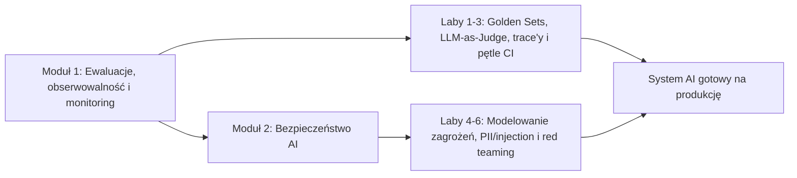

# Produkcyjna inżynieria AI: ewaluacje, obserwowalność i bezpieczeństwo

**Grupa docelowa:** Inżynierowie oprogramowania i AI budujący produkcyjne aplikacje oparte na LLM  
**Format:** 2 sesje półdniowe (2 × 3,5 godziny = łącznie 7 godzin, wliczając przerwy)  
**Stos technologiczny:** Python 3.11+, Langfuse (OpenTelemetry), Promptfoo + `pytest`, Microsoft Presidio oraz Garak / Promptfoo Red Team  
**Wymagania wstępne:** Znajomość API modeli LLM, podstawowych wzorców RAG/agentowych, Pythona oraz standardowych procesów CI/CD.  
**Stan narzędzi i standardów na:** listopad 2026

---

## Harmonogram sesji (2 × 3,5 godziny)

| Sesja | Blok | Czas | Zawartość |
| :--- | :--- | :--- | :--- |
| **Dzień 1** | Moduł 1.1 + Lab 1 | 75 min | Otwarcie, dlaczego tradycyjne testowanie zawodzi, Golden Datasets, analiza błędów i LLM-as-a-Judge |
| | *Przerwa* | 15 min | — |
| | Moduł 1.2 + Lab 2 | 60 min | Obserwowalność, tracing w Langfuse / OpenTelemetry i przegląd platform |
| | Moduł 1.3 + Lab 3 | 60 min | Produkcyjne pętle ewaluacji i bramki CI/CD (`promptfoo` + `pytest`) |
| **Dzień 2** | Moduł 2.1 + Lab 4 | 45 min | Podsumowanie dnia 1, powierzchnia ataku AI i modelowanie zagrożeń dla systemów agentowych |
| | Moduł 2.2 + Lab 5 | 75 min | Prompt injection, halucynacje i ochrona danych osobowych (`presidio`) |
| | *Przerwa* | 15 min | — |
| | Moduł 2.3 + Lab 6 | 75 min | Guardrails w czasie działania, automatyczny red teaming i governance produkcyjny |

5-minutowe otwarcie każdego dnia jest częścią jego pierwszego bloku. Moduł 2.3 dzieli się na 25 min wykładu, 30 min Labu 6 i 20 min governance oraz podsumowania.

Tematy, które nie mieszczą się w 7 godzinach (ewaluacja agentów, projektowanie agentów odpornych na injection, bezpieczeństwo MCP, RODO), omawia [dodatek do samodzielnej nauki](./appendix_take_home-pl.md).

---

## Przegląd programu

---

## Moduł 1: Ewaluacje AI, obserwowalność i monitoring

**Cel modułu:** Przeprowadzić inżynierów od „sprawdzania promptów na oko” (vibe-checking) do systematycznej, zautomatyzowanej ewaluacji i obserwowalności produkcyjnej, która wychwytuje regresje, zanim zrobią to użytkownicy.

### Część 1.1: Dlaczego tradycyjne testowanie zawodzi i jak poprawnie ewaluować (75 min, wliczając 5 min otwarcia)

#### Cele szkoleniowe
- Wyjaśnić, dlaczego deterministyczne testy jednostkowe nie sprawdzają się przy stochastycznych, otwartych odpowiedziach LLM.
- Zbudować reprezentatywny **Golden Dataset** oparty na rzeczywistych trybach awarii.
- Przeprowadzić ustrukturyzowaną **analizę błędów** (open coding + axial coding), aby zidentyfikować, co faktycznie się psuje.
- Projektować skalibrowane ewaluatory **LLM-as-a-Judge**, unikając typowych pułapek związanych z biasem.

#### Kluczowe zagadnienia
1. **Dlaczego tradycyjne testowanie zawodzi w przypadku AI**
   - *Niedeterminizm i zmienność formy:* Dokładne porównanie stringów/JSON-ów zawodzi, gdy dwie semantycznie identyczne odpowiedzi różnią się sformułowaniem.
   - *Nieskończona przestrzeń wejść:* Użytkownicy podają niejednoznaczne, złośliwe, wieloturowe i nietypowe (out-of-distribution) dane, których nie da się z góry wyliczyć.
   - *Cicha degradacja:* Aktualizacje modelu u dostawcy, poprawki promptów czy zmiany w chunkowaniu mogą subtelnie obniżyć jakość bez rzucania błędów HTTP 500.
   - *Piramida ewaluacji dla AI:*
     - **Asercje w kodzie (szybkie, tanie, deterministyczne):** poprawność schematu JSON, wyrażenia regularne, budżety opóźnień/tokenów, typy argumentów wywołań narzędzi.
     - **Metryki referencyjne (embeddingi/NLP):** przydatne do wąskich testów wyszukiwania (Recall@k, MRR), słabe w ocenie jakości otwartej generacji.
     - **LLM-as-a-Judge (skalowalna ocena semantyczna):** najlepsze do oceny wierności źródłom (faithfulness), tonu, zgodności z politykami i ukończenia zadania — pod warunkiem kalibracji względem etykiet ludzkich.
     - **Ocena przez człowieka (złoty standard):** służy do budowania Golden Datasets i audytu dryfu sędziego, a nie do blokowania każdego PR.

2. **Budowanie Golden Datasets**
   - Zacznij od małego zbioru (30–100 przykładów o wysokiej wartości), zamiast czekać na 10 000 syntetycznych wierszy.
   - Źródła: logi produkcyjne (zwłaszcza oceny „kciuk w dół” i eskalacje), taksonomie przypadków brzegowych, syntetyczne perturbacje i złośliwe przykłady startowe.
   - Stratyfikuj według intencji, trudności i poziomu ryzyka (np. rutynowe FAQ vs. operacje wysokiego ryzyka: finansowe, medyczne, modyfikujące stan przez narzędzia).
   - Dodaj pytania, na które kontekst nie odpowiada. Poprawną odpowiedzią jest wtedy odmowa (abstencja) i to właśnie ją jako pierwszą psuje zmiana promptu, która ma uczynić asystenta „bardziej pomocnym”.
   - Wersjonuj zbiory danych razem z promptami i kodem; traktuj kurację datasetu jako ciągły artefakt inżynierski.
   - Trace'y produkcyjne zawierają dane osobowe: pseudonimizuj je przed włączeniem do zbioru i zachowaj możliwość usunięcia wierszy danej osoby, także z Gita.

3. **Analiza błędów (przed napisaniem ewaluatorów)**
   - Nie zgaduj metryk w próżni — najpierw przejrzyj 50–100 rzeczywistych trace'ów.
   - *Open coding:* Opisz konkretne obserwacje błędów na surowych trace'ach (np. „pobrano niewłaściwy dokument z polityką”, „wymyślony parametr API”, „zignorowano negatywne ograniczenie”).
   - *Axial coding:* Pogrupuj obserwacje w 4–8 konkretnych trybów awarii i ustal priorytety według częstotliwości × dotkliwości.
   - Przypisz każdemu najważniejszemu trybowi awarii dedykowany ewaluator binarny (Pass/Fail) lub o wąskiej skali i etykietuj każdy tryb awarii osobno. Jedna ogólna etykieta nie powie, który ewaluator się myli.

4. **Dobre praktyki i pułapki LLM-as-a-Judge**
   - Preferuj **binarne Pass/Fail** (lub rubrykę 1–3) zamiast mglistych skal Likerta 1–5.
   - Wymagaj **pisemnej krytyki przed werdyktem**, aby sędzia najpierw rozumował, a dopiero potem oceniał.
   - Uważaj na znane biasy: *position bias* (porównania parami A/B), *verbosity bias* (dłuższe = lepsze), *self-preference* (GPT oceniający GPT).
   - **Kalibracja:** Zmierz zgodność sędziego z ludźmi (kappa Cohena lub precision/recall dla Pass/Fail) na wydzielonym, oetykietowanym zbiorze, zanim zaufasz sędziemu w CI.
     - Podawaj przedziały. Przy 8 błędach w zbiorze recall 7/8 pasuje do wszystkiego od ok. 53% do 98% (95% przedział Wilsona).
     - Najpierw sprawdź, czy osoby etykietujące zgadzają się ze sobą.

#### Warsztat praktyczny 1: Analiza błędów i skalibrowany LLM-as-a-Judge (35 min)
- **Przygotowanie:** 40 trace'ów bota wsparcia opartego na RAG (20 dev, 20 val) z kontekstami złożonymi z kilku dokumentów i jedną etykietą ludzką na każdy tryb awarii (format, cytowanie, wierność źródłom). Są też pytania, na które dokumenty nie odpowiadają i poprawną odpowiedzią jest odmowa.
- **Zadania:**
  1. Przeprowadź analizę błędów na 20 trace'ach dev (open i axial coding), zanim spojrzysz na etykiety.
  2. Przeczytaj deterministyczne sprawdzenia formatu i cytowań i ustal, które błędy wyłapie tylko ewaluator semantyczny.
  3. Uruchom mglistą rubrykę 1–5 jako punkt odniesienia, potem napisz binarnego sędziego wierności (rozumowanie przed werdyktem) i iteruj wyłącznie na dev.
  4. Zamroź prompt i zmierz go raz na val: precision i recall względem etykiety własnego trybu awarii sędziego, z 95% przedziałami i kappą.
- **Wniosek:** Zbiór jest zbudowany tak, żeby typowe błędy rubryki 1–5 były widoczne: karze poprawne odmowy i nagradza płynnie zmyślone odpowiedzi. Przedziały pokazują, jak niewiele da się udowodnić na 20 etykietach.

---

### Część 1.2: Obserwowalność, monitoring i przegląd platform (60 min)

#### Cele szkoleniowe
- Instrumentować aplikacje LLM za pomocą ustrukturyzowanych **trace'ów, spanów i metadanych** (w tym konwencji OpenTelemetry GenAI).
- Odróżniać **monitoring online** (opóźnienia, koszty, wskaźniki błędów, guardrails na żywo) od **ewaluacji offline**.
- Wybrać platformę do obserwowalności/ewaluacji dopasowaną do stosu zespołu, wymagań dotyczących lokalizacji danych i skali.

#### Kluczowe zagadnienia
1. **Anatomia trace'a LLM**
   - Pojedyncze żądanie użytkownika rzadko jest jednym wywołaniem LLM — to drzewo spanów: `request -> query_rewrite -> vector_retrieval -> rerank -> llm_generation -> tool_call -> final_synthesis`.
   - Kluczowe atrybuty każdego spanu: model/dostawca, szablon promptu + wersja, liczba tokenów (wejściowe/wyjściowe/z cache), opóźnienie (TTFT i całkowite), koszt, ID pobranych dokumentów oraz identyfikatory korelacji użytkownika/sesji.
   - Standaryzacja na **OpenTelemetry (GenAI Semantic Conventions)** pozwala uniknąć vendor lock-in przy zmianie backendu obserwowalności. Konwencje wciąż się zmieniają, więc przypnij wersję, którą emitujesz.

2. **Co monitorować na produkcji**
   - *Kondycja systemu i koszty:* TTFT, opóźnienia P95/P99, zużycie tokenów na użytkownika/funkcję, limity zapytań/błędy 429, częstość uruchamiania fallbacków.
   - *Sygnały jakości i zachowania:* feedback pośredni (ponowne prompty, kopiowanie/porzucenie, długość sesji), feedback bezpośredni (kciuk w górę/w dół), częstość zadziałania guardrails, odsetek pustych wyników wyszukiwania.
   - *Wykrywanie dryfu:* zmiany długości wejść, dryf embeddingów/tematów, nagłe skoki odmów lub błędów parsowania JSON po aktualizacji snapshotu modelu u dostawcy.
   - *Higiena trace'ów:* Trace'y zawierają prompty, pobrane dokumenty i dane użytkowników. Maskuj dane osobowe przed eksportem i ustaw retencję.

3. **Przegląd popularnych platform (macierz kompromisów, listopad 2026)**
   - **Open source / do samodzielnego hostowania:**
     - *Langfuse:* Mocny tracing, wersjonowanie promptów, datasety i pipeline'y ewaluacji; świetne wsparcie dla self-hostingu. W styczniu 2026 przejęty przez ClickHouse; rdzeń pozostaje na licencji MIT.
     - *Arize Phoenix:* Natywnie oparty na OpenTelemetry, mocna wizualizacja RAG/embeddingów i ewaluacje na poziomie trace'ów. Dynatrace przejął Arize w 2026 roku (ogłoszenie w sierpniu); Phoenix pozostaje open source.
     - *Opik (Comet):* Przyjazny dla developerów tracing, śledzenie eksperymentów i integracja ewaluacji z CI.
   - **Zarządzane / nastawione na ewaluację:**
     - *Braintrust:* Ścisła pętla między playgroundem, datasetami, scoringiem i bramkami regresji w CI/CD.
     - *LangSmith:* Najlepsza ergonomia, jeśli zespół już ustandaryzował się na LangChain/LangGraph.
   - **Lekkie narzędzia CLI / code-first do uruchamiania ewaluacji:**
     - *Promptfoo, DeepEval, Ragas, Inspect AI:* Idealne do lokalnych iteracji i GitHub Actions/GitLab CI bez ciężkiego uzależnienia od platformy. W marcu 2026 OpenAI ogłosiło przejęcie Promptfoo; Promptfoo pozostaje open source.
   - **Konsolidacja:** W 2026 roku Langfuse, Arize i Promptfoo zmieniły właściciela albo ogłosiły sprzedaż. Helicone, proxy/bramka, która była wcześniej na tej liście, w marcu 2026 trafiło do Mintlify i przeszło w tryb utrzymaniowy.
     - Wybieraj pod kątem przenośności: eksport przez OTLP, prompty i datasety ewaluacyjne, które da się przenieść, i żadnej logiki biznesowej w SDK dostawcy.
     - Gdy narzędzie do red teamingu należy do dostawcy modelu, który nim testujesz, miej to na uwadze i utrzymuj własne testy regresyjne.

#### Warsztat praktyczny 2: Tracing wieloetapowego agenta i diagnozowanie wąskich gardeł opóźnień/kosztów (25 min)
- **Przygotowanie:** Wolny, czteroetapowy agent wsparcia (przepisanie zapytania → wyszukiwanie wektorowe → dwa wywołania narzędzi → synteza), śledzony przez SDK Langfuse (oparte na OpenTelemetry) albo wypisywany lokalnie jako JSON.
- **Zadania:**
  1. Przeczytaj jeden trace, a potem przebieg 10 żądań. Ustal, gdzie ucieka czas: sekwencyjne wywołania narzędzi plus jedna zależność, która jest wolna tylko w ogonie rozkładu. Ustal, co napędza tokeny wejściowe: kontekst z k=20.
  2. Dodaj własne metadane spanów (`prompt_version`, `retrieval_k`, `user_tier`) i dołącz feedback użytkownika później, po ID trace'a, tak jak zrobiłby to endpoint feedbacku.
  3. Napraw: równoległe wywołania narzędzi z osobnym spanem potomnym dla każdego; pobierz 20, przerankuj, zostaw 4 i obserwuj `retrieval_hit`. Cięcie k na ślepo gubi odpowiedź.
- **Wniosek:** Nie da się optymalizować ani debugować czegoś, czego nie można przypisać do konkretnego spanu i wersji promptu, a P95 wymaga wielu żądań, nie jednego trace'a.

---

### Część 1.3: Produkcyjne pętle ewaluacji i integracja z CI/CD (60 min)

#### Cele szkoleniowe
- Zaprojektować ciągłą pętlę ewaluacji typu **flywheel (online → offline → bramka CI → online)**.
- Wdrożyć **bramki regresji** w CI/CD bez eksplozji czasu wykonania czy budżetu API.
- Bezpiecznie wdrażać zmiany promptów/modeli z użyciem **shadow traffic, wdrożeń kanarkowych i ewaluacji A/B**.

#### Kluczowe zagadnienia
1. **Ciągły flywheel ewaluacji**
   - Ruch produkcyjny → automatyczne scorery online / flagi guardrails / feedback użytkowników → triaż i przegląd przez człowieka → włączenie do Golden Dataset → uruchamianie w CI przy każdym PR → blokowanie regresji przed merge'em.
2. **Strategia bramek CI/CD (szybko vs. dogłębnie)**
   - *Na etapie PR (szybko, <2 min):* testy deterministyczne + mały, wartościowy zestaw smoke (20–50 przypadków) + tani/szybki model-sędzia.
   - *Nocne / przed wydaniem (dogłębnie):* pełny Golden Dataset (500+ przypadków), symulacje wieloturowe, zestaw testów adwersaryjnych i benchmarki przy zmianie modelu.
   - *Rygor statystyczny:* Uruchamiaj niedeterministyczne zestawy N razy lub stosuj porównania parami (baseline vs. kandydat na dokładnie tych samych wejściach) z przedziałami ufności, zamiast reagować na szum pojedynczego wiersza.
     - Dla niezawodności wymagaj **pass^k**: przypadek przechodzi we wszystkich k uruchomieniach, jak w τ-bench. Nie opieraj bramki na pass@k (przechodzi co najmniej jedno z k), bo nagradza niespójność.
   - *Wycinki danych (slice'y):* Stosuj bramkę dla każdego wycinka (intencja, poziom ryzyka, pytania „poza dokumentacją”). Próg zbiorczy potrafi ukryć wycinek, który spadł z 2/2 do 0/2.
3. **Wzorce bezpiecznego wdrażania**
   - Tryb shadow (asynchroniczne odtwarzanie wejść produkcyjnych na nowym promptcie/modelu i ocena offline). W agentach z narzędziami modyfikującymi stan zastąp atrapą (stubem) każdy efekt uboczny: przebieg shadow nigdy nie może wysłać e-maila.
   - Routing kanarkowy (5% ruchu) z automatycznymi wyzwalaczami rollbacku przy wzroście częstości zadziałania guardrails, błędów parsowania JSON lub skokach opóźnień. Te wyzwalacze nie widzą spadku jakości odpowiedzi, więc porównuj też oceny sędziego na próbkach ruchu kanarkowego i kontrolnego.

#### Warsztat praktyczny 3: Budowa bramki regresji w CI (30 min)
- **Przygotowanie:** Bazowy prompt; kandydat, który „tylko uprzejmiej formułuje odpowiedzi” (zachowuje JSON i cytowania, ale uzupełnia luki wiedzą ogólną); oraz Golden Dataset z 20 wierszami w wycinkach (`answerable`, `not_covered`).
  - Offline bramka odtwarza nagrane odpowiedzi, przypisane do skrótu SHA-256 promptu.
  - Prompt, którego nikt nie ewaluował, kończy się porażką (fail closed).
- **Zadania:**
  1. Przeczytaj diff z PR i przewidź, które wiersze się zregresują.
  2. Uruchom bramkę. Poprawność schematu wynosi 100% i ogólny próg jest spełniony, a mimo to porównanie parami w wycinkach nie przechodzi (`not_covered`: 2/2 → 0/2), a bramka wypisuje raport różnic dla przypadków, które zmieniły wynik.
  3. Popraw kandydata. Zewaluuj go na żywo, co uruchamia też sędziego wierności z Labu 1, albo porównaj z poprawką wzorcową.
- **Wniosek:** Progi zbiorcze przepuszczają ciche regresje. Porównania parami w wycinkach je łapią, a krytyczne wycinki potrzebują więcej wierszy, niż ma przykład demonstracyjny.

---

## Moduł 2: Bezpieczeństwo AI (security & safety)

**Cel modułu:** Wyposażyć inżynierów w umiejętność modelowania zagrożeń dla aplikacji LLM, obrony przed prompt injection i wyciekiem danych, egzekwowania guardrails w czasie działania oraz weryfikacji gotowości poprzez automatyczny red teaming.

### Część 2.1: Zrozumienie powierzchni ataku AI (45 min, wliczając 5 min podsumowania dnia 1)

#### Cele szkoleniowe
- Zmapować granice zaufania aplikacji AI (wejście użytkownika, dane pobierane w RAG, wyniki narzędzi, pamięć i wagi modelu).
- Zastosować **OWASP Top 10 for LLM Applications (2026)** i **OWASP Top 10 for Agentic Applications (2026)** do rzeczywistych architektur.
- Odróżnić tradycyjne podatności AppSec od specyficznego dla AI zlewania się warstwy sterowania (control plane) z warstwą danych (data plane).

#### Kluczowe zagadnienia
1. **Podstawowa wada architektoniczna: dane vs. instrukcje**
   - LLM przetwarzają instrukcje systemowe, prompty użytkownika, pobrane dokumenty i wyniki narzędzi w jednym strumieniu tokenów — nie ma sprzętowo wymuszonego rozdziału między kodem a danymi.
   - Każde niezaufane źródło tekstu (strony WWW, e-maile, PDF-y, zgłoszenia w Jirze, wiersze z bazy danych) trafiające do okna kontekstu jest potencjalnym **kanałem instrukcji**.
2. **Mapowanie powierzchni ataku (5 granic)**
   - *Granica wejścia:* Bezpośredni prompt injection, jailbreaki, przemycanie tokenów / sztuczki z kodowaniem.
   - *Granica wyszukiwania / RAG:* Pośredni prompt injection, zatruwanie korpusu, wycieki między tenantami przez ACL w bazach wektorowych.
   - *Granica narzędzi / agentowa:* Nadmierna autonomia (excessive agency), SSRF/SQLi przez argumenty narzędzi generowane przez LLM, eskalacja uprawnień typu confused deputy (agent działa ze wspólnym tokenem konta serwisowego zamiast z delegowanym tokenem użytkownika).
   - *Granica wyjścia:* XSS/wstrzykiwanie Markdown w UI, niebezpieczna obsługa wyjścia, zhalucynowane pakiety/URL-e (slopsquatting).
   - *Granica danych i łańcucha dostaw:* Wycieki danych treningowych/logów, skompromitowane wagi modelu oraz złośliwe lub przejęte serwery MCP/pluginy:
     - *Tool poisoning:* instrukcje ukryte w opisach narzędzi.
     - *Rug pull:* definicja narzędzia, która zmienia się po jej zatwierdzeniu.
     - *Token passthrough:* serwer przekazuje token użytkownika dalej, do innej usługi.
     - *Mitygacje:* przypinanie i przegląd definicji narzędzi, OAuth 2.1 z tokenami przypisanymi do odbiorcy (audience), zakresy uprawnień per narzędzie, serwery w sandboksie.
3. **Dwa modele myślowe dla agentów**
   - *„Zabójcza triada” (lethal trifecta, Simon Willison, 2025), dla poufności:*
     - (1) dostęp do prywatnych danych + (2) ekspozycja na niezaufane treści + (3) możliwość komunikacji na zewnątrz = eksfiltracja.
     - Przerwij jedną z nóg, zwykle kanał wyjścia (allowlista ruchu wychodzącego, żadnych dowolnych URL-i ani obrazków).
     - Przykład: w maju 2025 Invariant Labs pokazało, jak złośliwe zgłoszenie (issue) w publicznym repozytorium GitHub skłoniło agenta z serwerem GitHub MCP do wycieku danych z prywatnego repozytorium do publicznego pull requesta.
   - *Agents Rule of Two (Meta, październik 2025), dla każdej szkodliwej akcji:*
     - W jednej sesji agent powinien mieć najwyżej dwie z trzech właściwości: [A] przetwarza niezaufane wejście, [B] ma dostęp do wrażliwych systemów lub prywatnych danych, [C] zmienia stan lub komunikuje się na zewnątrz.
     - Triada nie ma nogi „zmiana stanu”, więc nie wyłapie wstrzykniętego `delete_workspace`. Rule of Two go obejmuje: usunięcie workspace'u klienta dotyka wrażliwego systemu i zmienia stan.
     - Jeśli zadanie wymaga wszystkich trzech, agent nie może działać autonomicznie: potrzebne jest zatwierdzenie przez człowieka albo inna wiarygodna walidacja, ewentualnie nowa sesja.

#### Warsztat praktyczny 4: Modelowanie zagrożeń agentowej aplikacji RAG (20 min)
- **Przygotowanie:** Architektura wewnętrznego asystenta firmowego: bot na Slacku (także w kanałach Slack Connect), RAG na Confluence, narzędzia zapisu do Jiry/e-maila, wspólny token konta serwisowego i narzędzie do obserwowalności w modelu SaaS.
- **Zadania:**
  1. Zmapuj niezaufane źródła, wrażliwe aktywa i ujścia (sinks), oddzielając aktywa (to, czego chce atakujący) od ujść (którędy dane wychodzą albo co zostaje zmienione).
  2. Udokumentuj 3 konkretne ścieżki ataku (np. zatruta strona w Confluence wywołująca eksfiltrację przez e-mail) i uszereguj je według wpływu × prawdopodobieństwa.
     - Przypisz każdą ścieżkę do OWASP LLM (2026) i OWASP Agentic (2026).
     - Dla każdej podaj mitygację, która nie zależy od poprawnego zachowania modelu, i wskaż, którą nogę triady albo którą właściwość z Rule of Two usuwa.
  3. Odpowiedz na pytania o tożsamość, odbiorców i logi. Wskazują ścieżki, które zespoły zwykle pomijają: confused deputy, odpowiedź bota widoczną dla całego kanału i dane HR w trace'ach.

---

### Część 2.2: Ataki, halucynacje oraz prywatność danych / ochrona PII (75 min)

#### Cele szkoleniowe
- Rozpoznawać i testować **bezpośredni/pośredni prompt injection**, jailbreaki i **wydobywanie promptu systemowego**.
- Ograniczać **ryzyka bezpieczeństwa wynikające z halucynacji** (zmyślone cytowania, slopsquatting, nieautoryzowane obietnice dotyczące polityk firmy).
- Wdrażać **wykrywanie i redakcję PII oraz izolację danych między tenantami** w promptach, logach i bazach wektorowych.

#### Kluczowe zagadnienia
1. **Prompt injection i typowe wzorce ataków**
   - *Bezpośrednie wstrzyknięcie:* Odgrywanie ról/persony, łamanie delimiterów, zaciemnianie przez base64/homoglify, stopniowa eskalacja w wielu turach (crescendo).
   - *Pośrednie wstrzyknięcie:* Ukryte instrukcje w pobranym HTML, biały tekst w PDF, stopki e-maili lub odpowiedzi narzędzi.
   - *Wydobywanie promptu systemowego i sekretów:* Nigdy nie umieszczaj kluczy API, danych dostępowych do baz ani poufnej logiki biznesowej w promptach systemowych — zakładaj, że prompty systemowe da się wydobyć.
   - *Niebezpieczna obsługa wyjścia:* Renderowanie surowego Markdown/HTML z LLM.
     - Obrazek (``) eksfiltruje dane bez żadnego kliknięcia; link wymaga jednego.
     - W klientach, których nie kontrolujesz, np. w Slacku, unfurling linków sprawia, że to serwer pobiera URL: znowu zero kliknięć.
     - EchoLeak (CVE-2025-32711, ujawniony w czerwcu 2025) pokazał to na produkcji: jeden spreparowany e-mail mógł skłonić Microsoft 365 Copilot do eksfiltracji danych bez żadnej interakcji użytkownika.
2. **Halucynacje jako ryzyko niezawodności i bezpieczeństwa**
   - *Halucynowanie pakietów (slopsquatting):* Atakujący rejestrują często halucynowane nazwy pakietów w npm/PyPI.
   - *Halucynacje dotyczące polityk/prawa:* Chatbot obiecujący zwroty lub SLA, których firma nie oferuje. W sprawie Moffatt v. Air Canada (2024) linia lotnicza odpowiadała za politykę taryf żałobnych, którą wymyślił jej chatbot.
   - Mitygacje: ścisłe ugruntowanie w źródłach, weryfikacja cytowań, ustrukturyzowane wyjścia (`enum` / ograniczenia schematu) oraz deterministyczna walidacja logiki biznesowej poza LLM.
3. **Prywatność danych, ochrona PII i bezpieczne przetwarzanie danych**
   - *Redakcja / pseudonimizacja przed wywołaniem LLM:* Wykrywaj i maskuj PII/sekrety (np. Microsoft Presidio, regex + NER) *przed* wysłaniem do zewnętrznych API modeli.
     - Używaj numerowanych placeholderów (`<PERSON_1>`), żeby model nadal odróżniał osoby.
     - Przywracaj wartości (re-hydracja) lokalnie, po sanityzacji wyjścia, żeby prawdziwe dane nigdy nie trafiły do URL-i.
     - Presidio to NER „na tyle, na ile się da”: zmierz jego recall na własnych danych i dodaj rozpoznawacze dla swojego kraju (ma np. rozpoznawacz polskiego numeru PESEL).
   - *Higiena obserwowalności:* Usuwaj PII/klucze API z logów trace'ów i datasetów ewaluacyjnych; egzekwuj okresy retencji (TTL).
   - *Autoryzacja w RAG (ACL na poziomie dokumentów):* Nigdy nie polegaj na prompcie LLM („pokazuj tylko dokumenty Alicji”) jako mechanizmie kontroli dostępu.
     - Egzekwuj filtry ACL tenanta/użytkownika *wewnątrz* zapytania do bazy wektorowej/wyszukiwarki, przed pobraniem danych.
     - Tożsamość bierz ze zweryfikowanej sesji, nigdy z żądania ani od modelu.
   - *Governance danych u dostawców:* Umowy zero-data-retention (ZDR), rezygnacja z wykorzystania danych do trenowania modeli dostawcy, regionalna lokalizacja danych.
   - *RODO:* Dane osobowe w promptach, trace'ach i Golden Datasets to przetwarzanie jak każde inne. Wymaga podstawy prawnej, DPIA tam, gdzie ryzyko jest wysokie, i ścieżki usuwania danych (szczegóły w dodatku do samodzielnej nauki).

#### Warsztat praktyczny 5: Łamanie i utwardzanie podatnego asystenta (40 min)
- **Przygotowanie:** Celowo podatny asystent RAG z narzędziem e-mail, ze wspólnym indeksem wielu tenantów i sesjami po stronie serwera dla stażystki i kierowniczki HR.
- **Zadania:**
  1. *Atak:* Uruchom trzy scenariusze.
     - Pytanie stażystki wciąga do promptu poufne dane HR.
     - Umowa innego klienta wycieka między tenantami.
     - Strona dostawcy naszpikowana słowami kluczowymi uruchamia eksfiltrację e-mailem oraz przez obrazek i link w Markdown.
  2. *Obrona:*
     - Wymuś filtry tenanta i uprawnień w warstwie pobierania, oparte na principalu z sesji.
     - Redaguj PII przez Presidio z numerowanymi, odwracalnymi placeholderami.
     - Dodaj sprawdzenie roli i allowlistę odbiorców w deterministycznym wrapperze narzędzia.
     - Usuwaj zewnętrzne obrazki i linki, sanityzując przed re-hydracją.
- **Wniosek:** Symulowany model wykonuje polecenia z injection w obu wersjach: wyciek zatrzymuje ograniczenie skutków (containment), a nie zachowanie modelu. W przypadku kierowniczki HR zatrzymuje go tylko allowlista odbiorców.

---

### Część 2.3: Guardrails, kontrole w czasie działania, red teaming i governance (75 min: 25 min wykładu, 30 min Labu 6, 20 min governance i podsumowania)

#### Cele szkoleniowe
- Zaprojektować **wielowarstwowe guardrails w czasie działania (defense-in-depth)** (warstwy: wejście, wyszukiwanie, wykonywanie narzędzi, wyjście) bez niszczenia opóźnień.
- Traktować wykrywanie injection jako sygnał, a granicę bezpieczeństwa umieszczać w deterministycznej autoryzacji.
- Uruchamiać zautomatyzowane zestawy **red teamingu** przeciwko modelom i aplikacjom.
- Ustanowić bramki **governance i gotowości produkcyjnej** przed uruchomieniem.

#### Kluczowe zagadnienia
1. **Warstwowe guardrails i kontrole polityk**
   - *Guardrails wejściowe:* Limity długości/częstości, allowlisty tematów/zakresu oraz wykrywanie injection heurystykami albo klasyfikatorami (np. Llama Prompt Guard 2, Lakera Guard, Azure Prompt Shields). Klasyfikatory bezpieczeństwa treści, takie jak Llama Guard, odpowiadają na inne pytanie: czy treść jest szkodliwa, a nie czy to injection.
   - **Wykrywanie to sygnał, a nie granica bezpieczeństwa:**
     - W pracy „The Attacker Moves Second” (2025) adaptacyjne ataki złamały 12 opublikowanych obron, przeważnie ze skutecznością powyżej 90%.
     - Używaj detektorów do ograniczania szumu, kwarantanny treści i zasilania telemetrii.
     - Granicę umieść w deterministycznej autoryzacji: co ten principal może zrobić z tym obiektem i dokąd mogą trafić dane.
   - *Guardrails wyszukiwania:* Filtry ACL w zapytaniu (część 2.2); oznaczanie granic niezaufanej treści (spotlighting). Spotlighting obniża skuteczność statycznych ataków, ale nie adaptacyjnych.
   - *Guardrails wykonania / narzędzi:*
     - Tokeny narzędzi z minimalnymi uprawnieniami (delegowany token użytkownika, a nie wspólne konto serwisowe), walidacja schematów, rozdzielenie narzędzi tylko do odczytu od modyfikujących, allowlisty ruchu wychodzącego.
     - Autoryzacja na poziomie obiektu przy każdym wywołaniu narzędzia: czy ten użytkownik może dotknąć tej faktury?
     - Potwierdzenie przez **człowieka w pętli (HITL)** dla akcji destrukcyjnych lub zewnętrznych. HITL to nie autoryzacja: najpierw autoryzuj, bo zmęczenie zatwierdzaniem (approval fatigue) robi z człowieka pieczątkę.
   - *Guardrails wyjściowe:* Sprawdzanie toksyczności/wycieków PII, kontrole ugruntowania/halucynacji, reguły polityk specyficzne dla domeny (np. NeMo Guardrails, Guardrails AI).
   - *Budżet opóźnień vs. bezpieczeństwo:* Szybkie kontrole deterministyczne/regex/małe klasyfikatory uruchamiaj synchronicznie; ciężkie kontrole bezpieczeństwa oparte na LLM — asynchronicznie lub tylko dla akcji wysokiego ryzyka.
2. **Automatyczny i manualny red teaming**
   - Traktuj red teaming jak testy penetracyjne + fuzzing dla AI.
   - Narzędzia: **Garak** (skaner podatności LLM, poziom modelu), **PyRIT** (framework Microsoftu do wieloturowego red teamingu), **Promptfoo redteam** (poziom aplikacji, przyjazny dla CI).
   - Testuj w kategoriach: jailbreaki, wycieki PII, pośredni injection, bias/toksyczność, manipulacja poza tematem/na rzecz konkurencji, nadmierna autonomia oraz dostęp do obiektów innych tenantów.
   - Czytaj wyniki jak ewaluację:
     - Generuj ataki z wyprzedzeniem, żeby przebiegi dało się porównać.
     - Grader to sędzia LLM: skalibruj go i czytaj jego porażki.
     - Pięć prób na plugin to poszukiwanie, a nie pomiar: 0/5 porażek nadal pasuje do odsetka porażek ok. 43%.
   - Każdy potwierdzony exploit dodawaj jako stały **test odtwarzający na poziomie systemu** (replay): nagrany atak przechodzi przez prawdziwą pętlę agenta, a odpowiedzi modelu są oskryptowane. Test jednostkowy jednej funkcji guardraila nie wystarczy.
3. **Governance i gotowość produkcyjna (20-minutowy blok razem z podsumowaniem)**
   - Inwentaryzacja modeli i promptów (jakie modele, jakie dane trafiają dokąd, status ZDR, które serwery MCP i definicje narzędzi).
   - Playbook reagowania na incydenty: kill switche (wyłączenie narzędzia/feature flagi), rollback promptu, fallback na innego dostawcę i bezpieczne stany awaryjne widoczne dla użytkownika.
   - **EU AI Act po Digital Omnibus** (rozporządzenie (UE) 2026/1744, obowiązuje od 27 lipca 2026):
     - Obowiązki przejrzystości z art. 50 stosuje się od 2 sierpnia 2026: informuj ludzi, że rozmawiają z AI, i oznaczaj treści syntetyczne.
     - Obowiązki dla systemów wysokiego ryzyka przesunięto na 2 grudnia 2027 (załącznik III) i 2 sierpnia 2028 (załącznik I).
     - Art. 4 wymaga teraz od dostawców i podmiotów stosujących podejmowania działań wspierających kompetencje w zakresie AI (AI literacy).
   - **RODO:** DPIA dla przetwarzania wysokiego ryzyka, minimalizacja danych i retencja w trace'ach, umowy powierzenia z dostawcami modeli i ścieżka usuwania danych, obejmująca też datasety ewaluacyjne.
   - Frameworki i audyt: mapowanie na NIST AI RMF, ISO/IEC 42001 dla systemu zarządzania, ścieżki audytu dla akcji agentowych.

#### Warsztat praktyczny 6: Guardrails w czasie działania i automatyczny red teaming (30 min)
- **Przygotowanie:** Agent wsparcia w wielotenantowym SaaS-ie z pięcioma narzędziami i wspólnym centrum pomocy, które zawiera pośredni injection. Każde wywołanie narzędzia przechodzi przez deterministyczną politykę z zalogowanym principalem, a przełącznik approval fatigue symuluje człowieka, który zatwierdza wszystko.
- **Zadania:**
  1. Zamień dwa znaleziska z red teamingu w padające testy odtwarzające na poziomie systemu: pośredni injection przy zmęczeniu zatwierdzaniem i dostęp do faktury innej organizacji.
  2. Domknij politykę narzędzi autoryzacją na poziomie obiektu i allowlistą odbiorców dla każdej organizacji.
  3. Uruchom skan `promptfoo redteam` na wcześniej wygenerowanych atakach i porównaj werdykty gradera z logiem narzędzi.
- **Wniosek:**
  - Regexowy tripwire łapie leniwy injection i przepuszcza ten, który wygląda jak procedura. Polityka narzędzi wytrzymuje w obu przypadkach.
  - Jej granicę widać przy zmęczeniu zatwierdzaniem: wstrzyknięta rotacja kluczy przez administratora nadal by się wykonała. To dokładnie przypadek, o którym mówi Rule of Two.

---

## Checklista gotowości produkcyjnej (materiał do zabrania)

- [ ] **Golden Dataset:** ≥50 wyselekcjonowanych, wersjonowanych przykładów pokrywających główne ścieżki + najważniejsze tryby awarii, także pytania, na które poprawną odpowiedzią jest odmowa.
- [ ] **Analiza błędów:** Udokumentowana taksonomia zaobserwowanych błędów przypisana do zautomatyzowanych ewaluatorów.
- [ ] **Skalibrowani sędziowie:** Prompty LLM-as-a-Judge zweryfikowane względem etykiet ludzkich, osobno dla każdego trybu awarii i z przedziałami (śledzone precision/recall).
- [ ] **Pełny tracing:** Każde żądanie śledzone end-to-end (wyszukiwanie, prompty, narzędzia, koszt, opóźnienie) z dołączonymi wersjami promptu/modelu.
- [ ] **Bramka ewaluacji w CI/CD:** Zautomatyzowany zestaw testów regresyjnych uruchamiany przy zmianach promptów/modeli/wyszukiwania przed merge'em. Porównuje baseline i kandydata w każdym wycinku i kończy się porażką dla promptów, których nikt nie ewaluował.
- [ ] **Bezpieczne wdrożenia:** Kanarki oceniane przez sędziów, a nie tylko przez wskaźniki błędów; przebiegi shadow z atrapami wszystkich efektów ubocznych.
- [ ] **Autoryzacja w wyszukiwaniu i narzędziach:** ACL egzekwowane w warstwie danych i wrapperach narzędzi — nigdy w prompcie.
  - Tożsamość pochodzi ze zweryfikowanej sesji.
  - Sprawdzenia na poziomie obiektu przy każdym wywołaniu narzędzia.
  - Delegowane tokeny użytkownika zamiast wspólnych kont serwisowych.
- [ ] **PII i higiena logów:** PII redagowane przed zewnętrznymi wywołaniami LLM (tam, gdzie wymagane) i usuwane z trace'ów obserwowalności; ścieżka usuwania danych z trace'ów i datasetów.
- [ ] **Obsługa wyjścia:** Zewnętrzne obrazki i linki usuwane albo na allowliście; unfurling linków wyłączony w klientach zewnętrznych.
- [ ] **Projekt agenta:** Rule of Two przejrzane dla każdego agenta; allowlista ruchu wychodzącego; wykrywanie injection jako telemetria, a nie granica bezpieczeństwa.
- [ ] **MCP i łańcuch dostaw:** Definicje narzędzi przypięte i przejrzane; tokeny przypisane do odbiorcy, bez token passthrough.
- [ ] **Guardrails w czasie działania i kill switch:** Kontrole wejścia/wyjścia, narzędzia z minimalnymi uprawnieniami, HITL dla modyfikacji wysokiego ryzyka i możliwość natychmiastowego rollbacku.
- [ ] **Bazowy red teaming:** Zautomatyzowany zestaw testów adwersaryjnych uruchomiony przed startem na stałym zestawie ataków ze skalibrowanym graderem; potwierdzone exploity dodane do CI jako testy odtwarzające na poziomie systemu.
- [ ] **Governance:** Przejrzystość wg AI Act (art. 50) i działania na rzecz AI literacy wdrożone; DPIA wykonana tam, gdzie jest wymagana.
