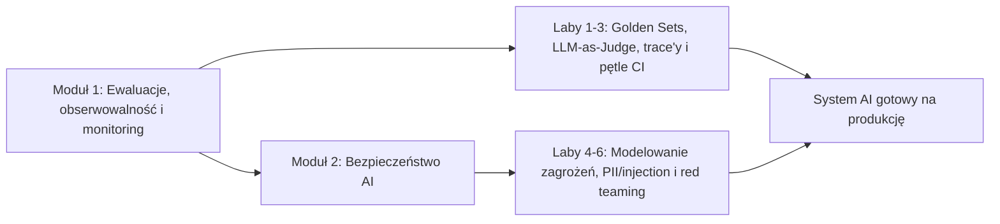

# Produkcyjna inżynieria AI: ewaluacje, obserwowalność i bezpieczeństwo

**Grupa docelowa:** Inżynierowie oprogramowania i AI budujący produkcyjne aplikacje oparte na LLM  
**Format:** 2 sesje półdniowe (2 × 3,5 godziny = łącznie 7 godzin, wliczając przerwy)  
**Stos technologiczny:** Python 3.11+, Langfuse (OpenTelemetry), Promptfoo + `pytest`, Microsoft Presidio oraz Garak / Promptfoo Red Team  
**Wymagania wstępne:** Znajomość API modeli LLM, podstawowych wzorców RAG/agentowych, Pythona oraz standardowych procesów CI/CD.

---

## Harmonogram sesji (2 × 3,5 godziny)

| Sesja | Blok | Czas | Zawartość |
| :--- | :--- | :--- | :--- |
| **Dzień 1** | Moduł 1.1 + Lab 1 | 75 min | Dlaczego tradycyjne testowanie zawodzi, Golden Datasets, analiza błędów i LLM-as-a-Judge |
| | *Przerwa* | 15 min | — |
| | Moduł 1.2 + Lab 2 | 60 min | Obserwowalność, tracing w Langfuse / OpenTelemetry i przegląd platform |
| | Moduł 1.3 + Lab 3 | 60 min | Produkcyjne pętle ewaluacji i bramki CI/CD (`promptfoo` + `pytest`) |
| **Dzień 2** | Moduł 2.1 + Lab 4 | 45 min | Powierzchnia ataku AI i modelowanie zagrożeń dla systemów agentowych |
| | Moduł 2.2 + Lab 5 | 75 min | Prompt injection, halucynacje i ochrona danych osobowych (`presidio`) |
| | *Przerwa* | 15 min | — |
| | Moduł 2.3 + Lab 6 | 75 min | Guardrails w czasie działania, automatyczny red teaming i governance produkcyjny |

---

## Przegląd programu

---

## Moduł 1: Ewaluacje AI, obserwowalność i monitoring

**Cel modułu:** Przeprowadzić inżynierów od „sprawdzania promptów na oko” (vibe-checking) do systematycznej, zautomatyzowanej ewaluacji i obserwowalności produkcyjnej, która wychwytuje regresje, zanim zrobią to użytkownicy.

### Część 1.1: Dlaczego tradycyjne testowanie zawodzi i jak poprawnie ewaluować (75 min)

#### Cele szkoleniowe
- Wyjaśnić, dlaczego deterministyczne testy jednostkowe nie sprawdzają się przy stochastycznych, otwartych odpowiedziach LLM.
- Zbudować reprezentatywny **Golden Dataset** oparty na rzeczywistych trybach awarii.
- Przeprowadzić ustrukturyzowaną **analizę błędów** (open coding + axial coding), aby zidentyfikować, co faktycznie się psuje.
- Projektować skalibrowane ewaluatory **LLM-as-a-Judge**, unikając typowych pułapek związanych z biasem.

#### Kluczowe zagadnienia
1. **Dlaczego tradycyjne testowanie zawodzi w przypadku AI**
   - *Niedeterminizm i zmienność formy:* Dokładne porównanie stringów/JSON-ów zawodzi, gdy dwie semantycznie identyczne odpowiedzi różnią się sformułowaniem.
   - *Nieskończona przestrzeń wejść:* Użytkownicy podają niejednoznaczne, złośliwe, wieloturowe i nietypowe (out-of-distribution) dane, których nie da się z góry wyliczyć.
   - *Cicha degradacja:* Aktualizacje modelu u dostawcy, poprawki promptów czy zmiany w chunkowaniu mogą subtelnie obniżyć jakość bez rzucania błędów HTTP 500.
   - *Piramida ewaluacji dla AI:*
     - **Asercje w kodzie (szybkie, tanie, deterministyczne):** poprawność schematu JSON, wyrażenia regularne, budżety opóźnień/tokenów, typy argumentów wywołań narzędzi.
     - **Metryki referencyjne (embeddingi/NLP):** przydatne do wąskich testów wyszukiwania (Recall@k, MRR), słabe w ocenie jakości otwartej generacji.
     - **LLM-as-a-Judge (skalowalna ocena semantyczna):** najlepsze do oceny wierności źródłom (faithfulness), tonu, zgodności z politykami i ukończenia zadania — pod warunkiem kalibracji względem etykiet ludzkich.
     - **Ocena przez człowieka (złoty standard):** służy do budowania Golden Datasets i audytu dryfu sędziego, a nie do blokowania każdego PR.

2. **Budowanie Golden Datasets**
   - Zacznij od małego zbioru (30–100 przykładów o wysokiej wartości), zamiast czekać na 10 000 syntetycznych wierszy.
   - Źródła: logi produkcyjne (zwłaszcza oceny „kciuk w dół” i eskalacje), taksonomie przypadków brzegowych, syntetyczne perturbacje i złośliwe przykłady startowe.
   - Stratyfikuj według intencji, trudności i poziomu ryzyka (np. rutynowe FAQ vs. operacje wysokiego ryzyka: finansowe, medyczne, modyfikujące stan przez narzędzia).
   - Wersjonuj zbiory danych razem z promptami i kodem; traktuj kurację datasetu jako ciągły artefakt inżynierski.

3. **Analiza błędów (przed napisaniem ewaluatorów)**
   - Nie zgaduj metryk w próżni — najpierw przejrzyj 50–100 rzeczywistych trace'ów.
   - *Open coding:* Opisz konkretne obserwacje błędów na surowych trace'ach (np. „pobrano niewłaściwy dokument z polityką”, „wymyślony parametr API”, „zignorowano negatywne ograniczenie”).
   - *Axial coding:* Pogrupuj obserwacje w 4–8 konkretnych trybów awarii i ustal priorytety według częstotliwości × dotkliwości.
   - Przypisz każdemu najważniejszemu trybowi awarii dedykowany ewaluator binarny (Pass/Fail) lub o wąskiej skali.

4. **Dobre praktyki i pułapki LLM-as-a-Judge**
   - Preferuj **binarne Pass/Fail** (lub rubrykę 1–3) zamiast mglistych skal Likerta 1–5.
   - Wymagaj **krytyki w formie chain-of-thought przed werdyktem**, aby sędzia najpierw rozumował, a dopiero potem oceniał.
   - Uważaj na znane biasy: *position bias* (porównania parami A/B), *verbosity bias* (dłuższe = lepsze), *self-preference* (GPT oceniający GPT).
   - **Kalibracja:** Zmierz zgodność sędziego z ludźmi (kappa Cohena lub precision/recall dla Pass/Fail) na wydzielonym, oetykietowanym zbiorze, zanim zaufasz sędziemu w CI.

#### Warsztat praktyczny 1: Analiza błędów i skalibrowany LLM-as-a-Judge (35 min)
- **Przygotowanie:** Przykładowy log trace'ów bota RAG/wsparcia (40 wierszy wejście/kontekst/wyjście z ok. 15 podrzuconymi realistycznymi błędami: zhalucynowane daty, pominięte ograniczenia, błędne argumenty narzędzi, nietrafione wyszukiwanie).
- **Zadania:**
  1. Przeprowadź analizę błędów na 20 trace'ach i skategoryzuj 3 najczęstsze tryby awarii.
  2. Napisz deterministyczny test w kodzie dla błędów strukturalnych/ograniczeń + binarny prompt LLM-as-a-Judge dla *ugruntowania w źródłach (Groundedness / Faithfulness)*.
  3. Uruchom sędziego na pozostałych 20 trace'ach oetykietowanych przez ludzi i policz precision/recall względem etykiet ludzkich.
- **Wniosek:** Uczestnicy na własne oczy widzą, jak słabo zdefiniowana rubryka 1–5 rozmija się z ocenami ludzi, a skoncentrowana rubryka binarna + krok rozumowania radykalnie poprawia zgodność.

---

### Część 1.2: Obserwowalność, monitoring i przegląd platform (60 min)

#### Cele szkoleniowe
- Instrumentować aplikacje LLM za pomocą ustrukturyzowanych **trace'ów, spanów i metadanych** (w tym konwencji OpenTelemetry GenAI).
- Odróżniać **monitoring online** (opóźnienia, koszty, wskaźniki błędów, guardrails na żywo) od **ewaluacji offline**.
- Wybrać platformę do obserwowalności/ewaluacji dopasowaną do stosu zespołu, wymagań dotyczących lokalizacji danych i skali.

#### Kluczowe zagadnienia
1. **Anatomia trace'a LLM**
   - Pojedyncze żądanie użytkownika rzadko jest jednym wywołaniem LLM — to drzewo spanów: `request -> query_rewrite -> vector_retrieval -> rerank -> llm_generation -> tool_call -> final_synthesis`.
   - Kluczowe atrybuty każdego spanu: model/dostawca, szablon promptu + wersja, liczba tokenów (wejściowe/wyjściowe/z cache), opóźnienie (TTFT i całkowite), koszt, ID pobranych dokumentów oraz identyfikatory korelacji użytkownika/sesji.
   - Standaryzacja na **OpenTelemetry (GenAI Semantic Conventions)** pozwala uniknąć vendor lock-in przy zmianie backendu obserwowalności.

2. **Co monitorować na produkcji**
   - *Kondycja systemu i koszty:* TTFT, opóźnienia P95/P99, zużycie tokenów na użytkownika/funkcję, limity zapytań/błędy 429, częstość uruchamiania fallbacków.
   - *Sygnały jakości i zachowania:* feedback pośredni (ponowne prompty, kopiowanie/porzucenie, długość sesji), feedback bezpośredni (kciuk w górę/w dół), częstość zadziałania guardrails, odsetek pustych wyników wyszukiwania.
   - *Wykrywanie dryfu:* zmiany długości wejść, dryf embeddingów/tematów, nagłe skoki odmów lub błędów parsowania JSON po aktualizacji snapshotu modelu u dostawcy.

3. **Przegląd popularnych platform (macierz kompromisów)**
   - **Open source / do samodzielnego hostowania:**
     - *Langfuse:* Mocny tracing, wersjonowanie promptów, datasety i pipeline'y ewaluacji; świetne wsparcie dla self-hostingu.
     - *Arize Phoenix:* Natywnie oparty na OpenTelemetry, mocna wizualizacja RAG/embeddingów i ewaluacje na poziomie trace'ów.
     - *Opik (Comet):* Przyjazny dla developerów tracing, śledzenie eksperymentów i integracja ewaluacji z CI.
   - **Zarządzane / nastawione na ewaluację:**
     - *Braintrust:* Ścisła pętla między playgroundem, datasetami, scoringiem i bramkami regresji w CI/CD.
     - *LangSmith:* Najlepsza ergonomia, jeśli zespół już ustandaryzował się na LangChain/LangGraph.
     - *Helicone:* Lekka bramka typu proxy do cache'owania, śledzenia kosztów i limitowania zapytań.
   - **Lekkie narzędzia CLI / code-first do uruchamiania ewaluacji:**
     - *Promptfoo, DeepEval, Ragas, Inspect AI:* Idealne do lokalnych iteracji i GitHub Actions/GitLab CI bez ciężkiego uzależnienia od platformy.

#### Warsztat praktyczny 2: Tracing wieloetapowego agenta i diagnozowanie wąskich gardeł opóźnień/kosztów (25 min)
- **Przygotowanie:** Zepsuty/wolny 3-etapowy skrypt RAG + wywołania narzędzi, zinstrumentowany przez OpenTelemetry / Langfuse (lub lokalną przeglądarkę trace'ów).
- **Zadania:**
  1. Dodaj własne metadane spanów (`prompt_version`, `retrieval_k`, `user_tier`) i dołącz ocenę użytkownika do ID trace'a.
  2. Przeanalizuj trace'y, aby ustalić, dlaczego wzrosło opóźnienie P95 (np. sekwencyjne wywołania narzędzi lub zbyt duży pobrany kontekst) i który etap odpowiada za 80% kosztu tokenów.
- **Wniosek:** Nie da się optymalizować ani debugować czegoś, czego nie można przypisać do konkretnego spanu i wersji promptu.

---

### Część 1.3: Produkcyjne pętle ewaluacji i integracja z CI/CD (60 min)

#### Cele szkoleniowe
- Zaprojektować ciągłą pętlę ewaluacji typu **flywheel (online → offline → bramka CI → online)**.
- Wdrożyć **bramki regresji** w CI/CD bez eksplozji czasu wykonania czy budżetu API.
- Bezpiecznie wdrażać zmiany promptów/modeli z użyciem **shadow traffic, wdrożeń kanarkowych i ewaluacji A/B**.

#### Kluczowe zagadnienia
1. **Ciągły flywheel ewaluacji**
   - Ruch produkcyjny → automatyczne scorery online / flagi guardrails / feedback użytkowników → triaż i przegląd przez człowieka → włączenie do Golden Dataset → uruchamianie w CI przy każdym PR → blokowanie regresji przed merge'em.
2. **Strategia bramek CI/CD (szybko vs. dogłębnie)**
   - *Na etapie PR (szybko, <2 min):* testy deterministyczne + mały, wartościowy zestaw smoke (20–50 przypadków) + tani/szybki model-sędzia.
   - *Nocne / przed wydaniem (dogłębnie):* pełny Golden Dataset (500+ przypadków), symulacje wieloturowe, zestaw testów adwersaryjnych i benchmarki przy zmianie modelu.
   - *Rygor statystyczny:* Uruchamiaj niedeterministyczne zestawy N razy lub stosuj porównania parami (baseline vs. kandydat na dokładnie tych samych wejściach) z przedziałami ufności, zamiast reagować na szum pojedynczego wiersza.
3. **Wzorce bezpiecznego wdrażania**
   - Tryb shadow (asynchroniczne odtwarzanie wejść produkcyjnych na nowym promptcie/modelu i ocena offline).
   - Routing kanarkowy (5% ruchu) z automatycznymi wyzwalaczami rollbacku przy wzroście częstości zadziałania guardrails, błędów parsowania JSON lub skokach opóźnień.

#### Warsztat praktyczny 3: Budowa bramki regresji w CI (30 min)
- **Przygotowanie:** Repozytorium z bazowym promptem, „zregresowanym” promptem kandydującym (np. poprawia ton, ale psuje poprawność cytowań) oraz Golden Dataset.
- **Zadania:**
  1. Skonfiguruj automatyczny runner ewaluacji (np. Promptfoo lub pytest + LLM-as-Judge) do porównania `baseline` vs. `candidate`.
  2. Wprowadź politykę progów (np. `schema_validity == 100%`, `faithfulness >= 0.90`, `brak regresji >5% w żadnym wycinku danych`).
  3. Zaobserwuj, jak bramka CI wychwytuje cichą regresję i generuje raport różnic dla nieudanych przypadków.

---

## Moduł 2: Bezpieczeństwo AI (security & safety)

**Cel modułu:** Wyposażyć inżynierów w umiejętność modelowania zagrożeń dla aplikacji LLM, obrony przed prompt injection i wyciekiem danych, egzekwowania guardrails w czasie działania oraz weryfikacji gotowości poprzez automatyczny red teaming.

### Część 2.1: Zrozumienie powierzchni ataku AI (45 min)

#### Cele szkoleniowe
- Zmapować granice zaufania aplikacji AI (wejście użytkownika, dane pobierane w RAG, wyniki narzędzi, pamięć i wagi modelu).
- Zastosować **OWASP Top 10 for LLM Applications** do rzeczywistych architektur.
- Odróżnić tradycyjne podatności AppSec od specyficznego dla AI zlewania się warstwy sterowania (control plane) z warstwą danych (data plane).

#### Kluczowe zagadnienia
1. **Podstawowa wada architektoniczna: dane vs. instrukcje**
   - LLM przetwarzają instrukcje systemowe, prompty użytkownika, pobrane dokumenty i wyniki narzędzi w jednym strumieniu tokenów — nie ma sprzętowo wymuszonego rozdziału między kodem a danymi.
   - Każde niezaufane źródło tekstu (strony WWW, e-maile, PDF-y, zgłoszenia w Jirze, wiersze z bazy danych) trafiające do okna kontekstu jest potencjalnym **kanałem instrukcji**.
2. **Mapowanie powierzchni ataku (5 granic)**
   - *Granica wejścia:* Bezpośredni prompt injection, jailbreaki, przemycanie tokenów / sztuczki z kodowaniem.
   - *Granica wyszukiwania / RAG:* Pośredni prompt injection, zatruwanie korpusu, wycieki między tenantami przez ACL w bazach wektorowych.
   - *Granica narzędzi / agentowa:* Nadmierna autonomia (excessive agency), SSRF/SQLi przez argumenty narzędzi generowane przez LLM, eskalacja uprawnień typu confused deputy.
   - *Granica wyjścia:* XSS/wstrzykiwanie Markdown w UI, niebezpieczna obsługa wyjścia, zhalucynowane pakiety/URL-e (slopsquatting).
   - *Granica danych i łańcucha dostaw:* Wycieki danych treningowych/logów, złośliwe serwery MCP/pluginy, skompromitowane wagi modelu.
3. **„Zabójcza triada” (Lethal Trifecta) dla agentów**
   - Połączenie **(1) dostępu do prywatnych danych + (2) ekspozycji na niezaufane treści + (3) możliwości komunikacji na zewnątrz / modyfikacji stanu** tworzy krytyczne ryzyko eksfiltracji. Przerwanie dowolnej z tych nóg (np. human-in-the-loop dla zapisów zewnętrznych) drastycznie ogranicza zasięg szkód.

#### Warsztat praktyczny 4: Modelowanie zagrożeń agentowej aplikacji RAG (20 min)
- **Przygotowanie:** Diagram architektury wewnętrznego asystenta firmowego (bot na Slacku + RAG na Confluence + narzędzia zapisu do Jiry/e-maila).
- **Zadania:**
  1. Zidentyfikuj wszystkie niezaufane źródła danych i uprzywilejowane ujścia (sinks).
  2. Udokumentuj 3 konkretne ścieżki ataku (np. zatruta strona w Confluence wywołująca eksfiltrację przez e-mail) i uszereguj je według wpływu × prawdopodobieństwa.

---

### Część 2.2: Ataki, halucynacje oraz prywatność danych / ochrona PII (75 min)

#### Cele szkoleniowe
- Rozpoznawać i testować **bezpośredni/pośredni prompt injection**, jailbreaki i **wydobywanie promptu systemowego**.
- Ograniczać **ryzyka bezpieczeństwa wynikające z halucynacji** (zmyślone cytowania, slopsquatting, nieautoryzowane obietnice dotyczące polityk firmy).
- Wdrażać **wykrywanie i redakcję PII oraz izolację danych między tenantami** w promptach, logach i bazach wektorowych.

#### Kluczowe zagadnienia
1. **Prompt injection i typowe wzorce ataków**
   - *Bezpośrednie wstrzyknięcie:* Odgrywanie ról/persony, łamanie delimiterów, zaciemnianie przez base64/homoglify, stopniowa eskalacja w wielu turach (crescendo).
   - *Pośrednie wstrzyknięcie:* Ukryte instrukcje w pobranym HTML, biały tekst w PDF, stopki e-maili lub odpowiedzi narzędzi.
   - *Wydobywanie promptu systemowego i sekretów:* Nigdy nie umieszczaj kluczy API, danych dostępowych do baz ani poufnej logiki biznesowej w promptach systemowych — zakładaj, że prompty systemowe da się wydobyć.
   - *Niebezpieczna obsługa wyjścia:* Renderowanie surowego Markdown/HTML z LLM (`` umożliwia bezkliknięciową eksfiltrację danych przez URL-e obrazków).
2. **Halucynacje jako ryzyko niezawodności i bezpieczeństwa**
   - *Halucynowanie pakietów (slopsquatting):* Atakujący rejestrują często halucynowane nazwy pakietów w npm/PyPI.
   - *Halucynacje dotyczące polityk/prawa:* Chatbot obiecujący zwroty lub SLA, których firma nie oferuje.
   - Mitygacje: ścisłe ugruntowanie w źródłach, weryfikacja cytowań, ustrukturyzowane wyjścia (`enum` / ograniczenia schematu) oraz deterministyczna walidacja logiki biznesowej poza LLM.
3. **Prywatność danych, ochrona PII i bezpieczne przetwarzanie danych**
   - *Redakcja / pseudonimizacja przed wywołaniem LLM:* Wykrywaj i maskuj PII/sekrety (np. Microsoft Presidio, regex + NER) *przed* wysłaniem do zewnętrznych API modeli, w razie potrzeby przywracając tokeny po otrzymaniu odpowiedzi.
   - *Higiena obserwowalności:* Usuwaj PII/klucze API z logów trace'ów i datasetów ewaluacyjnych; egzekwuj okresy retencji (TTL).
   - *Autoryzacja w RAG (ACL na poziomie dokumentów):* Nigdy nie polegaj na prompcie LLM („pokazuj tylko dokumenty Alicji”) jako mechanizmie kontroli dostępu — egzekwuj filtry ACL tenanta/użytkownika *wewnątrz* zapytania do bazy wektorowej/wyszukiwarki, przed pobraniem danych.
   - *Governance danych u dostawców:* Umowy zero-data-retention (ZDR), rezygnacja z wykorzystania danych do trenowania modeli dostawcy, regionalna lokalizacja danych.

#### Warsztat praktyczny 5: Łamanie i utwardzanie podatnego asystenta (40 min)
- **Przygotowanie:** Celowo podatna aplikacja RAG korzystająca z narzędzi.
- **Zadania:**
  1. *Atak:* Przeprowadź pośredni prompt injection przez pobrany dokument, aby wykraść sekret lub wywołać nieautoryzowane wywołanie narzędzia, oraz uruchom payload eksfiltrujący dane przez obrazek w Markdown.
  2. *Obrona:* Dodaj redakcję PII przed wywołaniem LLM, wymuś filtrowanie ACL na metadanych w bazie wektorowej, sanityzuj renderowane linki Markdown i przenieś wrażliwe sprawdzenia autoryzacji do deterministycznych wrapperów narzędzi.

---

### Część 2.3: Guardrails, kontrole w czasie działania, red teaming i governance (75 min)

#### Cele szkoleniowe
- Zaprojektować **wielowarstwowe guardrails w czasie działania (defense-in-depth)** (warstwy: wejście, wyszukiwanie, wykonywanie narzędzi, wyjście) bez niszczenia opóźnień.
- Uruchamiać zautomatyzowane zestawy **red teamingu** przeciwko modelom i aplikacjom.
- Ustanowić bramki **governance i gotowości produkcyjnej** przed uruchomieniem.

#### Kluczowe zagadnienia
1. **Warstwowe guardrails i kontrole polityk**
   - *Guardrails wejściowe:* Limity długości/częstości, szybka detekcja injection oparta na klasyfikatorach/heurystykach (np. Lakera Guard, Llama Guard, Prompt Guard), allowlisty tematów/zakresu.
   - *Guardrails wykonania / narzędzi:* Tokeny narzędzi z minimalnymi uprawnieniami, walidacja schematów, rozdzielenie narzędzi tylko do odczytu od modyfikujących, potwierdzenie przez **człowieka w pętli (HITL)** dla akcji destrukcyjnych lub zewnętrznych.
   - *Guardrails wyjściowe:* Sprawdzanie toksyczności/wycieków PII, kontrole ugruntowania/halucynacji, reguły polityk specyficzne dla domeny (np. NeMo Guardrails, Guardrails AI).
   - *Budżet opóźnień vs. bezpieczeństwo:* Szybkie kontrole deterministyczne/regex/małe klasyfikatory uruchamiaj synchronicznie; ciężkie kontrole bezpieczeństwa oparte na LLM — asynchronicznie lub tylko dla akcji wysokiego ryzyka.
2. **Automatyczny i manualny red teaming**
   - Traktuj red teaming jak testy penetracyjne + fuzzing dla AI.
   - Narzędzia: **Garak** (skaner podatności LLM), **PyRIT** (framework Microsoftu do wieloturowego red teamingu), plugin **Promptfoo redteam**.
   - Testuj w kategoriach: jailbreaki, wycieki PII, pośredni injection, bias/toksyczność, manipulacja poza tematem/na rzecz konkurencji oraz nadmierna autonomia.
   - Każdy udany exploit z red teamingu dodawaj bezpośrednio do Golden Dataset z Modułu 1 jako stały test regresyjny.
3. **Governance i checklista gotowości produkcyjnej**
   - Inwentaryzacja modeli i promptów (jakie modele, jakie dane trafiają dokąd, status ZDR).
   - Playbook reagowania na incydenty: kill switche (wyłączenie narzędzia/feature flagi), rollback promptu, fallback na innego dostawcę i bezpieczne stany awaryjne widoczne dla użytkownika.
   - Zgodność regulacyjna: klasyfikacja ryzyka wg EU AI Act, mapowanie na NIST AI RMF, ścieżki audytu dla akcji agentowych.

#### Warsztat praktyczny 6: Guardrails w czasie działania i automatyczny red teaming (30 min)
- **Przygotowanie:** Utwardzona aplikacja z Labu 5 + konfiguracja automatycznego red teamingu.
- **Zadania:**
  1. Podłącz klasyfikator wykrywający injection na wejściu + deterministyczną bramkę HITL/polityki dla wywołania narzędzia modyfikującego stan.
  2. Uruchom automatyczny skan red teamingowy (np. Promptfoo redteam lub Garak) przeciwko endpointowi, przeanalizuj wskaźnik skuteczności ataków (ASR) i zamień 2 wykryte błędy w stałe testy regresyjne w CI.

---

## Checklista gotowości produkcyjnej (materiał do zabrania)

- [ ] **Golden Dataset:** ≥50 wyselekcjonowanych, wersjonowanych przykładów pokrywających główne ścieżki + najważniejsze tryby awarii.
- [ ] **Analiza błędów:** Udokumentowana taksonomia zaobserwowanych błędów przypisana do zautomatyzowanych ewaluatorów.
- [ ] **Skalibrowani sędziowie:** Prompty LLM-as-a-Judge zweryfikowane względem etykiet ludzkich (śledzone precision/recall).
- [ ] **Pełny tracing:** Każde żądanie śledzone end-to-end (wyszukiwanie, prompty, narzędzia, koszt, opóźnienie) z dołączonymi wersjami promptu/modelu.
- [ ] **Bramka ewaluacji w CI/CD:** Zautomatyzowany zestaw testów regresyjnych uruchamiany przy zmianach promptów/modeli/wyszukiwania przed merge'em.
- [ ] **Autoryzacja w wyszukiwaniu i narzędziach:** ACL egzekwowane w warstwie danych i wrapperach narzędzi — nigdy w prompcie.
- [ ] **PII i higiena logów:** PII redagowane przed zewnętrznymi wywołaniami LLM (tam, gdzie wymagane) i usuwane z trace'ów obserwowalności.
- [ ] **Guardrails w czasie działania i kill switch:** Kontrole wejścia/wyjścia, narzędzia z minimalnymi uprawnieniami, HITL dla modyfikacji wysokiego ryzyka i możliwość natychmiastowego rollbacku.
- [ ] **Bazowy red teaming:** Zautomatyzowany zestaw testów adwersaryjnych uruchomiony przed startem, a wykryte exploity dodane do CI.
