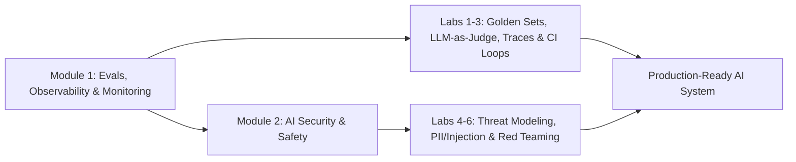

# Production AI Engineering: Evals, Observability & Security

**Target Audience:** Software & AI Engineers building production LLM applications  
**Format:** 2 Half-Day Sessions (2 × 3.5 hours = 7 hours total, including breaks)  
**Tech Stack:** Python 3.11+, Langfuse (OpenTelemetry), Promptfoo + `pytest`, Microsoft Presidio, and Garak / Promptfoo Red Team  
**Prerequisites:** Familiarity with LLM APIs, basic RAG/agentic patterns, Python, and standard CI/CD workflows.

---

## Session Schedule (2 × 3.5 Hours)

| Session | Block | Duration | Content |
| :--- | :--- | :--- | :--- |
| **Day 1** | Unit 1.1 + Lab 1 | 75 min | Why Traditional Testing Fails, Golden Datasets, Failure Analysis & LLM-as-a-Judge |
| | *Break* | 15 min | — |
| | Unit 1.2 + Lab 2 | 60 min | Observability, Langfuse / OpenTelemetry Tracing & Platform Landscape |
| | Unit 1.3 + Lab 3 | 60 min | Production Eval Loops & CI/CD Gates (`promptfoo` + `pytest`) |
| **Day 2** | Unit 2.1 + Lab 4 | 45 min | AI Threat Surface & Agentic Threat Modeling |
| | Unit 2.2 + Lab 5 | 75 min | Prompt Injection, Hallucinations & PII Protection (`presidio`) |
| | *Break* | 15 min | — |
| | Unit 2.3 + Lab 6 | 75 min | Runtime Guardrails, Automated Red Teaming & Production Governance |

---

## Curriculum Overview

---

## Module 1: AI Evals, Observability & Monitoring

**Module Goal:** Move engineers from "vibe-checking" prompts to systematic, automated evaluation and production observability that catches regressions before users do.

### Unit 1.1: Why Traditional Testing Fails & How to Evaluate Properly (75 min)

#### Learning Objectives
- Explain why deterministic unit tests break down for stochastic, open-ended LLM outputs.
- Construct a representative **Golden Dataset** grounded in real failure modes.
- Run structured **Error / Failure Analysis** (open coding + axial coding) to identify what actually breaks.
- Design calibrated **LLM-as-a-Judge** evaluators without falling into common bias traps.

#### Talking Points
1. **Why Traditional Testing Fails for AI**
   - *Non-determinism & surface variation:* Exact string/JSON equality fails when two semantically identical answers differ in phrasing.
   - *Infinite input space:* Users supply ambiguous, adversarial, multi-turn, and out-of-distribution inputs you cannot enumerate upfront.
   - *Silent degradation:* Upstream model updates, prompt tweaks, or chunking changes can shift quality subtly without throwing HTTP 500s.
   - *The Eval Pyramid for AI:*
     - **Code-based assertions (fast, cheap, deterministic):** JSON schema validity, regex checks, latency/token budgets, tool-call argument types.
     - **Reference-based metrics (embedding/NLP):** Useful for narrow retrieval checks (Recall@k, MRR), weak for open-ended generation quality.
     - **LLM-as-a-Judge (scalable semantic grading):** Best for faithfulness, tone, policy adherence, and task completion—when calibrated against human labels.
     - **Human review (gold standard):** Used to bootstrap Golden Datasets and audit judge drift, not to gate every PR.

2. **Building Golden Datasets**
   - Start small (30–100 high-signal examples) rather than waiting for 10,000 synthetic rows.
   - Sources: production logs (especially thumbs-down / escalations), edge-case taxonomies, synthetic perturbations, and adversarial seeds.
   - Stratify by intent, difficulty, and risk tier (e.g., routine FAQ vs. high-stakes financial/medical/tool-mutating actions).
   - Version datasets alongside prompts and code; treat dataset curation as an ongoing engineering artifact.

3. **Failure Analysis (Before Writing Evaluators)**
   - Don't guess metrics in a vacuum—inspect 50–100 real traces first.
   - *Open coding:* Annotate specific failure observations on raw traces (e.g., "retrieved wrong policy doc", "invented API parameter", "ignored negative constraint").
   - *Axial coding:* Group observations into 4–8 concrete failure modes and prioritize by frequency × severity.
   - Map each top failure mode to a dedicated binary (Pass/Fail) or narrow-scale evaluator.

4. **LLM-as-a-Judge Best Practices & Pitfalls**
   - Prefer **binary Pass/Fail** (or 1–3 rubric) over vague 1–5 Likert scales.
   - Require **chain-of-thought critique before the verdict** so the judge reasons before scoring.
   - Watch out for known biases: *position bias* (pairwise A/B), *verbosity bias* (longer = better), *self-preference* (GPT judging GPT).
   - **Calibration:** Measure judge-human agreement (Cohen's κ or precision/recall on Pass/Fail) on a held-out labeled split before trusting the judge in CI.

#### Hands-On Lab 1: Failure Analysis & Calibrated LLM-as-a-Judge (35 min)
- **Setup:** Provide a sample RAG/support-bot trace log (40 input/context/output rows with ~15 planted realistic failures: hallucinated dates, missed constraints, wrong tool args, retrieval misses).
- **Tasks:**
  1. Perform failure analysis on 20 traces and categorize the top 3 failure modes.
  2. Write a deterministic code check for structural/constraint failures + a binary LLM-as-a-Judge prompt for *Groundedness / Faithfulness*.
  3. Run the judge against the remaining 20 human-labeled traces and compute precision/recall against the human labels.
- **Takeaway:** Engineers see firsthand how a poorly specified 1–5 rubric disagrees with humans, and how a focused binary rubric + reasoning step dramatically improves alignment.

---

### Unit 1.2: Observability, Monitoring & Platform Landscape (60 min)

#### Learning Objectives
- Instrument LLM applications with structured **traces, spans, and metadata** (including OpenTelemetry GenAI conventions).
- Distinguish **online monitoring** (latency, cost, error rates, live guardrails) from **offline evaluation**.
- Select an observability/eval platform that fits team stack, data-residency, and scale requirements.

#### Talking Points
1. **Anatomy of an LLM Trace**
   - A single user request is rarely one LLM call—it's a tree of spans: `request -> query_rewrite -> vector_retrieval -> rerank -> llm_generation -> tool_call -> final_synthesis`.
   - Essential attributes per span: model/provider, prompt template + version, token counts (input/output/cached), latency (TTFT & total), cost, retrieved doc IDs, and user/session correlation IDs.
   - Standardizing on **OpenTelemetry (GenAI Semantic Conventions)** avoids vendor lock-in when switching observability backends.

2. **What to Monitor in Production**
   - *System & Cost Health:* TTFT, P95/P99 latency, token burn per user/feature, rate-limit/429s, fallback trigger rate.
   - *Quality & Behavioral Signals:* Implicit feedback (re-prompts, copy/abandonment, session length), explicit feedback (thumbs up/down), guardrail trigger rates, empty-retrieval rates.
   - *Drift Detection:* Input length shifts, embedding/topic drift, sudden spikes in refusal or JSON-parse failures after a provider model snapshot update.

3. **Survey of Popular Platforms (Trade-off Matrix)**
   - **Open-Source / Self-Hostable:**
     - *Langfuse:* Strong tracing, prompt versioning, datasets, and eval pipelines; great self-hosting story.
     - *Arize Phoenix:* OpenTelemetry-native, strong RAG/embedding visualization and trace-level evals.
     - *Opik (Comet):* Developer-friendly tracing, experiment tracking, and CI eval integration.
   - **Managed / Eval-First:**
     - *Braintrust:* Tight loop between playground, datasets, scoring, and CI/CD regression gates.
     - *LangSmith:* Deepest ergonomics if already standardized on LangChain/LangGraph.
     - *Helicone:* Lightweight proxy-first gateway for caching, cost tracking, and rate limiting.
   - **Lightweight CLI / Code-First Eval Runners:**
     - *Promptfoo, DeepEval, Ragas, Inspect AI:* Ideal for local iteration and GitHub Actions/GitLab CI without heavy platform lock-in.

#### Hands-On Lab 2: Tracing a Multi-Step Agent & Diagnosing Latency/Cost Bottlenecks (25 min)
- **Setup:** A broken/slow 3-step RAG + tool-calling script instrumented with OpenTelemetry / Langfuse (or local trace viewer).
- **Tasks:**
  1. Add custom span metadata (`prompt_version`, `retrieval_k`, `user_tier`) and attach a user feedback score to a trace ID.
  2. Inspect traces to pinpoint why P95 latency spiked (e.g., sequential tool calls or oversized retrieved context) and which step drives 80% of token cost.
- **Takeaway:** You cannot optimize or debug what you cannot attribute to a specific span and prompt version.

---

### Unit 1.3: Production-Ready Eval Loops & CI/CD Integration (60 min)

#### Learning Objectives
- Design a continuous **Flywheel (Online → Offline → CI Gate → Online)** eval loop.
- Implement **regression gates** in CI/CD without blowing up latency or API budgets.
- Safely roll out prompt/model changes using **shadow traffic, canary releases, and A/B evals**.

#### Talking Points
1. **The Continuous Eval Flywheel**
   - Production traffic → Automated online scorers / guardrail flags / user feedback → Triage & human review → Promoted into Golden Dataset → Runs in CI on every PR → Blocks regressions before merge.
2. **CI/CD Gating Strategy (Fast vs. Deep)**
   - *PR-time (Fast, <2 min):* Deterministic checks + small high-signal smoke dataset (20–50 cases) + cheap/fast judge model.
   - *Nightly / Pre-release (Deep):* Full Golden Dataset (500+ cases), multi-turn simulations, adversarial suite, and model-upgrade benchmarks.
   - *Statistical rigor:* Run non-deterministic suites N times or use paired comparisons (baseline vs. candidate on the exact same inputs) with confidence intervals rather than reacting to 1-row noise.
3. **Safe Rollout Patterns**
   - Shadow mode (replay production inputs asynchronously against new prompt/model, score offline).
   - Canary routing (5% traffic) with automated rollback triggers on guardrail-hit rate, JSON parse error rate, or latency spikes.

#### Hands-On Lab 3: Building a CI Regression Gate (30 min)
- **Setup:** Repo with a baseline prompt, a "regressed" candidate prompt (e.g., fixes tone but breaks citation accuracy), and a Golden Dataset.
- **Tasks:**
  1. Configure an automated eval runner (e.g., Promptfoo or pytest + LLM-as-Judge) to compare `baseline` vs. `candidate`.
  2. Enforce a threshold policy (e.g., `schema_validity == 100%`, `faithfulness >= 0.90`, `no >5% regression on any slice`).
  3. Observe the CI gate catch the silent regression and output a diff report of failed cases.

---

## Module 2: AI Security & Safety

**Module Goal:** Equip engineers to threat-model LLM applications, defend against prompt injection and data leakage, enforce runtime guardrails, and validate readiness via automated red teaming.

### Unit 2.1: Understanding the AI Threat Surface (45 min)

#### Learning Objectives
- Map an AI application's trust boundaries (user input, retrieved RAG data, tool outputs, memory, and model weights).
- Apply the **OWASP Top 10 for LLM Applications** to real architectures.
- Distinguish traditional AppSec vulnerabilities from AI-native control-plane/data-plane conflation.

#### Talking Points
1. **The Core Architectural Flaw: Data vs. Instructions**
   - LLMs process system instructions, user prompts, retrieved documents, and tool outputs in a single token stream—there is no hardware-enforced separation between code and data.
   - Every untrusted text source (web pages, emails, PDFs, Jira tickets, DB rows) entering the context window is a potential **instruction channel**.
2. **Threat Surface Mapping (The 5 Boundaries)**
   - *Input Boundary:* Direct prompt injection, jailbreaks, token-smuggling / encoding tricks.
   - *Retrieval / RAG Boundary:* Indirect prompt injection, corpus poisoning, cross-tenant ACL leakage in vector DBs.
   - *Tool / Agentic Boundary:* Excessive agency, SSRF/SQLi via LLM-generated tool args, confused-deputy privilege escalation.
   - *Output Boundary:* XSS/Markdown injection in UI, insecure output handling, hallucinated packages/URLs (slopsquatting).
   - *Data & Supply Chain Boundary:* Training/logging data leakage, malicious MCP servers/plugins, compromised model weights.
3. **The "Lethal Trifecta" for Agents**
   - Combining **(1) Access to private data + (2) Exposure to untrusted content + (3) Ability to externally communicate/mutate state** creates critical exfiltration risk. Breaking any one leg (e.g., human-in-the-loop for external writes) drastically reduces blast radius.

#### Hands-On Lab 4: Threat Modeling an Agentic RAG App (20 min)
- **Setup:** Architecture diagram of an internal company assistant (Slack bot + Confluence RAG + Jira/Email write tools).
- **Tasks:**
  1. Identify all untrusted data sources and privileged sinks.
  2. Document 3 concrete attack paths (e.g., poisoned Confluence page triggering email exfiltration) and rank by impact × likelihood.

---

### Unit 2.2: Attacks, Hallucinations & Data Privacy / PII Protection (75 min)

#### Learning Objectives
- Recognize and test for **direct/indirect prompt injection**, jailbreaks, and **system prompt extraction**.
- Mitigate **hallucination-driven security risks** (fabricated citations, slopsquatting, unauthorized policy promises).
- Implement **PII detection, redaction, and tenant-isolated data handling** across prompts, logs, and vector stores.

#### Talking Points
1. **Prompt Injection & Common Attack Patterns**
   - *Direct Injection:* Roleplay/persona framing, delimiter breaking, base64/homoglyph obfuscation, multi-turn gradual escalation (crescendo).
   - *Indirect Injection:* Hidden instructions in scraped HTML, PDF white-text, email signatures, or tool responses.
   - *System Prompt & Secret Extraction:* Never put API keys, DB credentials, or proprietary business logic secrets inside system prompts—assume system prompts are extractable.
   - *Insecure Output Handling:* Rendering raw LLM Markdown/HTML (`` for zero-click data exfiltration via image URLs).
2. **Hallucinations as a Reliability & Security Risk**
   - *Package hallucination (slopsquatting):* Attackers register commonly hallucinated npm/PyPI package names.
   - *Policy/legal hallucinations:* Chatbot promising refunds or SLAs the company doesn't offer.
   - Mitigations: Strict grounding, citation verification, structured outputs (`enum` / schema constraints), and deterministic business-logic validation outside the LLM.
3. **Data Privacy, PII Protection & Secure Data Handling**
   - *Pre-LLM Redaction / Pseudonymization:* Detect and mask PII/secrets (e.g., Microsoft Presidio, regex + NER) *before* sending to third-party model APIs, restoring tokens post-response if needed.
   - *Observability Hygiene:* Scrub PII/API keys from trace logs and eval datasets; enforce retention TTLs.
   - *RAG Authorization (Document-Level ACLs):* Never rely on the LLM prompt ("only show Alice's docs") for access control—enforce tenant/user ACL filters *inside* the vector/search query before retrieval.
   - *Vendor Data Governance:* Zero-data-retention (ZDR) agreements, opt-out of provider training, regional data residency.

#### Hands-On Lab 5: Breaking & Hardening a Vulnerable Assistant (40 min)
- **Setup:** A deliberately vulnerable RAG + tool-using app.
- **Tasks:**
  1. *Attack:* Execute an indirect prompt injection via a retrieved document to exfiltrate a secret or trigger an unauthorized tool call, and trigger a Markdown image-exfiltration payload.
  2. *Defend:* Add pre-LLM PII redaction, enforce vector-DB metadata ACL filtering, sanitize rendered Markdown links, and move sensitive authorization checks into deterministic tool wrappers.

---

### Unit 2.3: Guardrails, Runtime Checks, Red Teaming & Governance (75 min)

#### Learning Objectives
- Architect **defense-in-depth runtime guardrails** (input, retrieval, tool-execution, and output layers) without destroying latency.
- Run automated **red teaming** suites against models and applications.
- Establish **governance and production readiness** gates before launch.

#### Talking Points
1. **Layered Guardrails & Policy Controls**
   - *Input Guardrails:* Length/rate limits, fast classifier/heuristic injection detection (e.g., Lakera Guard, Llama Guard, Prompt Guard), topic/scope allowlists.
   - *Execution / Tool Guardrails:* Least-privilege tool tokens, schema validation, read-only vs. mutating tool separation, **Human-in-the-Loop (HITL)** confirmation for destructive or external actions.
   - *Output Guardrails:* Toxicity/PII leak checks, groundedness/hallucination checks, domain-specific policy rules (e.g., NeMo Guardrails, Guardrails AI).
   - *Latency vs. Safety Budget:* Run fast deterministic/regex/small-classifier checks synchronously; run heavy LLM-based safety checks asynchronously or only on high-risk actions.
2. **Automated & Manual Red Teaming**
   - Treat red teaming like penetration testing + fuzzing for AI.
   - Tools: **Garak** (LLM vulnerability scanner), **PyRIT** (Microsoft's multi-turn red teaming framework), **Promptfoo redteam** plugin.
   - Test across categories: jailbreaks, PII leakage, indirect injection, bias/toxicity, off-topic/competitor manipulation, and excessive agency.
   - Feed every successful red-team exploit directly back into the Module 1 Golden Dataset as a permanent regression test.
3. **Governance & Production Readiness Checklist**
   - Model & prompt inventory (what models, what data goes where, ZDR status).
   - Incident response playbook: kill switches (disable tool/feature flag), prompt rollback, provider fallback, and user-facing safe failure states.
   - Compliance alignment: EU AI Act risk tiering, NIST AI RMF mapping, audit trails for agentic actions.

#### Hands-On Lab 6: Runtime Guardrails & Automated Red Teaming (30 min)
- **Setup:** Hardened app from Lab 5 + automated red-teaming config.
- **Tasks:**
  1. Wire up an input injection classifier + a deterministic HITL/policy gate on a mutating tool call.
  2. Run an automated red-team scan (e.g., Promptfoo redteam or Garak) against the endpoint, inspect the attack success rate (ASR), and convert 2 discovered failures into permanent CI regression tests.

---

## Production Readiness Checklist (Take-Home Reference)

- [ ] **Golden Dataset:** ≥50 curated, versioned examples covering core flows + top failure modes.
- [ ] **Failure Analysis:** Documented taxonomy of observed failures mapped to automated evaluators.
- [ ] **Calibrated Judges:** LLM-as-a-Judge prompts validated against human labels (precision/recall tracked).
- [ ] **Full-Stack Tracing:** Every request traced end-to-end (retrieval, prompts, tools, cost, latency) with prompt/model versions attached.
- [ ] **CI/CD Eval Gate:** Automated regression suite runs on prompt/model/retrieval changes before merge.
- [ ] **AuthZ in Retrieval & Tools:** ACLs enforced in the data layer and tool wrappers—never in the prompt.
- [ ] **PII & Log Hygiene:** PII redacted before external LLM calls (where required) and scrubbed from observability traces.
- [ ] **Runtime Guardrails & Kill Switch:** Input/output checks, least-privilege tools, HITL for high-risk mutations, and instant rollback capability.
- [ ] **Red Team Baseline:** Automated adversarial suite run pre-launch with discovered exploits added to CI.
