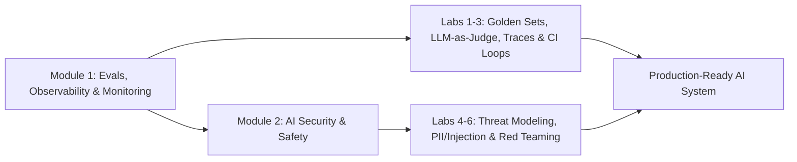

# Production AI Engineering: Evals, Observability & Security

**Target Audience:** Software & AI Engineers building production LLM applications  
**Format:** 2 Half-Day Sessions (2 × 3.5 hours = 7 hours total, including breaks)  
**Tech Stack:** Python 3.11+, Langfuse (OpenTelemetry), Promptfoo + `pytest`, Microsoft Presidio, and Garak / Promptfoo Red Team  
**Prerequisites:** Familiarity with LLM APIs, basic RAG/agentic patterns, Python, and standard CI/CD workflows.  
**Tools and standards as of:** November 2026

---

## Session Schedule (2 × 3.5 Hours)

| Session | Block | Duration | Content |
| :--- | :--- | :--- | :--- |
| **Day 1** | Unit 1.1 + Lab 1 | 75 min | Opening, Why Traditional Testing Fails, Golden Datasets, Failure Analysis & LLM-as-a-Judge |
| | *Break* | 15 min | — |
| | Unit 1.2 + Lab 2 | 60 min | Observability, Langfuse / OpenTelemetry Tracing & Platform Landscape |
| | Unit 1.3 + Lab 3 | 60 min | Production Eval Loops & CI/CD Gates (`promptfoo` + `pytest`) |
| **Day 2** | Unit 2.1 + Lab 4 | 45 min | Day 1 Recap, AI Threat Surface & Agentic Threat Modeling |
| | Unit 2.2 + Lab 5 | 75 min | Prompt Injection, Hallucinations & PII Protection (`presidio`) |
| | *Break* | 15 min | — |
| | Unit 2.3 + Lab 6 | 75 min | Runtime Guardrails, Automated Red Teaming & Production Governance |

The 5-minute opening of each day is part of its first block. Unit 2.3 splits into 25 min of talk, 30 min of Lab 6 and 20 min of governance and wrap-up.

Topics that do not fit into 7 hours (evaluating agents, injection-resistant agent design, MCP security, GDPR) are covered in the [take-home appendix](./appendix_take_home.md).

---

## Curriculum Overview

---

## Module 1: AI Evals, Observability & Monitoring

**Module Goal:** Move engineers from "vibe-checking" prompts to systematic, automated evaluation and production observability that catches regressions before users do.

### Unit 1.1: Why Traditional Testing Fails & How to Evaluate Properly (75 min, including the 5-min opening)

#### Learning Objectives
- Explain why deterministic unit tests break down for stochastic, open-ended LLM outputs.
- Construct a representative **Golden Dataset** grounded in real failure modes.
- Run structured **Error / Failure Analysis** (open coding + axial coding) to identify what actually breaks.
- Design calibrated **LLM-as-a-Judge** evaluators without falling into common bias traps.

#### Talking Points
1. **Why Traditional Testing Fails for AI**
   - *Non-determinism & surface variation:* Exact string/JSON equality fails when two semantically identical answers differ in phrasing.
   - *Infinite input space:* Users supply ambiguous, adversarial, multi-turn, and out-of-distribution inputs you cannot enumerate upfront.
   - *Silent degradation:* Upstream model updates, prompt tweaks, or chunking changes can shift quality subtly without throwing HTTP 500s.
   - *The Eval Pyramid for AI:*
     - **Code-based assertions (fast, cheap, deterministic):** JSON schema validity, regex checks, latency/token budgets, tool-call argument types.
     - **Reference-based metrics (embedding/NLP):** Useful for narrow retrieval checks (Recall@k, MRR), weak for open-ended generation quality.
     - **LLM-as-a-Judge (scalable semantic grading):** Best for faithfulness, tone, policy adherence, and task completion—when calibrated against human labels.
     - **Human review (gold standard):** Used to bootstrap Golden Datasets and audit judge drift, not to gate every PR.

2. **Building Golden Datasets**
   - Start small (30–100 high-signal examples) rather than waiting for 10,000 synthetic rows.
   - Sources: production logs (especially thumbs-down / escalations), edge-case taxonomies, synthetic perturbations, and adversarial seeds.
   - Stratify by intent, difficulty, and risk tier (e.g., routine FAQ vs. high-stakes financial/medical/tool-mutating actions).
   - Include questions the context cannot answer. The correct output is an abstention, and it is the first behavior a "more helpful" prompt edit breaks.
   - Version datasets alongside prompts and code; treat dataset curation as an ongoing engineering artifact.
   - Production traces contain personal data: pseudonymize them before promotion and keep a way to delete a person's rows, in Git too.

3. **Failure Analysis (Before Writing Evaluators)**
   - Don't guess metrics in a vacuum—inspect 50–100 real traces first.
   - *Open coding:* Annotate specific failure observations on raw traces (e.g., "retrieved wrong policy doc", "invented API parameter", "ignored negative constraint").
   - *Axial coding:* Group observations into 4–8 concrete failure modes and prioritize by frequency × severity.
   - Map each top failure mode to a dedicated binary (Pass/Fail) or narrow-scale evaluator, and label each failure mode separately. A single overall label cannot tell you which evaluator is wrong.

4. **LLM-as-a-Judge Best Practices & Pitfalls**
   - Prefer **binary Pass/Fail** (or 1–3 rubric) over vague 1–5 Likert scales.
   - Require **a written critique before the verdict** so the judge reasons before scoring.
   - Watch out for known biases: *position bias* (pairwise A/B), *verbosity bias* (longer = better), *self-preference* (GPT judging GPT).
   - **Calibration:** Measure judge-human agreement (Cohen's κ or precision/recall on Pass/Fail) on a held-out labeled split before trusting the judge in CI.
     - Report intervals. With 8 failures in the split, a recall of 7/8 is compatible with anything from about 53% to 98% (95% Wilson interval).
     - Check that the human labelers agree with each other first.

#### Hands-On Lab 1: Failure Analysis & Calibrated LLM-as-a-Judge (35 min)
- **Setup:** 40 traces from a RAG support bot (20 dev, 20 val) with multi-document contexts, one human label per failure mode (format, citation, faithfulness), and questions the documents do not answer, where the correct output is an abstention.
- **Tasks:**
  1. Run failure analysis on the 20 dev traces (open and axial coding) before looking at the labels.
  2. Read the deterministic format and citation checks, and decide which failures only a semantic evaluator can catch.
  3. Run a vague 1–5 rubric as the baseline, then write a binary faithfulness judge (reasoning before the verdict) and iterate on dev only.
  4. Freeze the prompt and measure once on val: precision and recall against the judge's own failure-mode label, with 95% intervals and κ.
- **Takeaway:** The dataset is built so that the 1–5 rubric's typical errors are visible: it penalizes correct abstentions and rewards fluent inventions. The intervals show how little 20 labels can prove.

---

### Unit 1.2: Observability, Monitoring & Platform Landscape (60 min)

#### Learning Objectives
- Instrument LLM applications with structured **traces, spans, and metadata** (including OpenTelemetry GenAI conventions).
- Distinguish **online monitoring** (latency, cost, error rates, live guardrails) from **offline evaluation**.
- Select an observability/eval platform that fits team stack, data-residency, and scale requirements.

#### Talking Points
1. **Anatomy of an LLM Trace**
   - A single user request is rarely one LLM call—it's a tree of spans: `request -> query_rewrite -> vector_retrieval -> rerank -> llm_generation -> tool_call -> final_synthesis`.
   - Essential attributes per span: model/provider, prompt template + version, token counts (input/output/cached), latency (TTFT & total), cost, retrieved doc IDs, and user/session correlation IDs.
   - Standardizing on **OpenTelemetry (GenAI Semantic Conventions)** avoids vendor lock-in when switching observability backends. The conventions are still evolving, so pin the version you emit.

2. **What to Monitor in Production**
   - *System & Cost Health:* TTFT, P95/P99 latency, token burn per user/feature, rate-limit/429s, fallback trigger rate.
   - *Quality & Behavioral Signals:* Implicit feedback (re-prompts, copy/abandonment, session length), explicit feedback (thumbs up/down), guardrail trigger rates, empty-retrieval rates.
   - *Drift Detection:* Input length shifts, embedding/topic drift, sudden spikes in refusal or JSON-parse failures after a provider model snapshot update.
   - *Trace hygiene:* Traces hold prompts, retrieved documents and user data. Mask personal data before export and set retention.

3. **Survey of Popular Platforms (Trade-off Matrix, November 2026)**
   - **Open-Source / Self-Hostable:**
     - *Langfuse:* Strong tracing, prompt versioning, datasets, and eval pipelines; great self-hosting story. Acquired by ClickHouse in January 2026; the core stays MIT-licensed.
     - *Arize Phoenix:* OpenTelemetry-native, strong RAG/embedding visualization and trace-level evals. Dynatrace acquired Arize in 2026 (announced in August); Phoenix stays open source.
     - *Opik (Comet):* Developer-friendly tracing, experiment tracking, and CI eval integration.
   - **Managed / Eval-First:**
     - *Braintrust:* Tight loop between playground, datasets, scoring, and CI/CD regression gates.
     - *LangSmith:* Deepest ergonomics if already standardized on LangChain/LangGraph.
   - **Lightweight CLI / Code-First Eval Runners:**
     - *Promptfoo, DeepEval, Ragas, Inspect AI:* Ideal for local iteration and GitHub Actions/GitLab CI without heavy platform lock-in. OpenAI announced the acquisition of Promptfoo in March 2026; Promptfoo stays open source.
   - **Consolidation:** In 2026 Langfuse, Arize and Promptfoo changed owners or announced a sale. Helicone, a proxy/gateway that used to be on this list, was bought by Mintlify in March 2026 and went into maintenance mode.
     - Choose for portability: OTLP export, prompts and eval datasets you can move, and no business logic inside a vendor's SDK.
     - When the red-teaming tool belongs to the vendor of the model it tests, know that, and keep your own regression tests.

#### Hands-On Lab 2: Tracing a Multi-Step Agent & Diagnosing Latency/Cost Bottlenecks (25 min)
- **Setup:** A slow four-step support agent (query rewrite → vector retrieval → two tool calls → synthesis), traced with the Langfuse SDK (OpenTelemetry-based) or printed locally as JSON.
- **Tasks:**
  1. Read one trace and then a 10-request run. Find where the latency goes: sequential tool calls, plus one dependency that is slow only in the tail. Find what drives the input tokens: a k=20 context.
  2. Add custom span metadata (`prompt_version`, `retrieval_k`, `user_tier`) and attach the user's feedback afterwards, by trace ID, the way a feedback endpoint would.
  3. Fix it: parallel tool calls with one child span each; retrieve 20, rerank, keep 4, and watch `retrieval_hit`. Cutting k blind loses the answer.
- **Takeaway:** You cannot optimize or debug what you cannot attribute to a specific span and prompt version, and P95 needs many requests, not one trace.

---

### Unit 1.3: Production-Ready Eval Loops & CI/CD Integration (60 min)

#### Learning Objectives
- Design a continuous **Flywheel (Online → Offline → CI Gate → Online)** eval loop.
- Implement **regression gates** in CI/CD without blowing up latency or API budgets.
- Safely roll out prompt/model changes using **shadow traffic, canary releases, and A/B evals**.

#### Talking Points
1. **The Continuous Eval Flywheel**
   - Production traffic → Automated online scorers / guardrail flags / user feedback → Triage & human review → Promoted into Golden Dataset → Runs in CI on every PR → Blocks regressions before merge.
2. **CI/CD Gating Strategy (Fast vs. Deep)**
   - *PR-time (Fast, <2 min):* Deterministic checks + small high-signal smoke dataset (20–50 cases) + cheap/fast judge model.
   - *Nightly / Pre-release (Deep):* Full Golden Dataset (500+ cases), multi-turn simulations, adversarial suite, and model-upgrade benchmarks.
   - *Statistical rigor:* Run non-deterministic suites N times or use paired comparisons (baseline vs. candidate on the exact same inputs) with confidence intervals rather than reacting to 1-row noise.
     - For reliability, require **pass^k**: the case passes in all k runs, as in τ-bench. Do not gate on pass@k (at least one of k passes), which rewards inconsistency.
   - *Slices:* Gate per slice (intent, risk tier, "not covered" questions). An aggregate threshold can hide a slice that dropped from 2/2 to 0/2.
3. **Safe Rollout Patterns**
   - Shadow mode (replay production inputs asynchronously against new prompt/model, score offline). For agents with mutating tools, stub every side effect: a shadow run must never send the email.
   - Canary routing (5% traffic) with automated rollback triggers on guardrail-hit rate, JSON parse error rate, or latency spikes. These triggers cannot see a drop in answer quality, so also compare judge scores on sampled canary and control traffic.

#### Hands-On Lab 3: Building a CI Regression Gate (30 min)
- **Setup:** A baseline prompt; a candidate that "only makes the assistant friendlier" (it keeps JSON and citations, but fills gaps with general knowledge); and a 20-row Golden Dataset with slices (`answerable`, `not_covered`).
  - Offline, the gate replays recorded outputs keyed by the prompt's SHA-256.
  - It fails closed on a prompt nobody evaluated.
- **Tasks:**
  1. Read the PR diff and predict which rows regress.
  2. Run the gate. Schema validity is 100% and the overall bar is cleared, yet the paired per-slice comparison fails (`not_covered`: 2/2 → 0/2) and prints a diff report of the flipped cases.
  3. Fix the candidate. Evaluate it live, which also runs the faithfulness judge from Lab 1, or compare it with the reference fix.
- **Takeaway:** Aggregate thresholds let silent regressions through. Paired per-slice comparisons catch them, and critical slices need more rows than a demo has.

---

## Module 2: AI Security & Safety

**Module Goal:** Equip engineers to threat-model LLM applications, defend against prompt injection and data leakage, enforce runtime guardrails, and validate readiness via automated red teaming.

### Unit 2.1: Understanding the AI Threat Surface (45 min, including the 5-min Day 1 recap)

#### Learning Objectives
- Map an AI application's trust boundaries (user input, retrieved RAG data, tool outputs, memory, and model weights).
- Apply the **OWASP Top 10 for LLM Applications (2026)** and the **OWASP Top 10 for Agentic Applications (2026)** to real architectures.
- Distinguish traditional AppSec vulnerabilities from AI-native control-plane/data-plane conflation.

#### Talking Points
1. **The Core Architectural Flaw: Data vs. Instructions**
   - LLMs process system instructions, user prompts, retrieved documents, and tool outputs in a single token stream—there is no hardware-enforced separation between code and data.
   - Every untrusted text source (web pages, emails, PDFs, Jira tickets, DB rows) entering the context window is a potential **instruction channel**.
2. **Threat Surface Mapping (The 5 Boundaries)**
   - *Input Boundary:* Direct prompt injection, jailbreaks, token-smuggling / encoding tricks.
   - *Retrieval / RAG Boundary:* Indirect prompt injection, corpus poisoning, cross-tenant ACL leakage in vector DBs.
   - *Tool / Agentic Boundary:* Excessive agency, SSRF/SQLi via LLM-generated tool args, confused-deputy privilege escalation (the agent acts with a shared service-account token instead of the user's delegated one).
   - *Output Boundary:* XSS/Markdown injection in UI, insecure output handling, hallucinated packages/URLs (slopsquatting).
   - *Data & Supply Chain Boundary:* Training/logging data leakage, compromised model weights, and malicious or compromised MCP servers/plugins:
     - *Tool poisoning:* instructions hidden in tool descriptions.
     - *Rug pulls:* a tool definition that changes after you approved it.
     - *Token passthrough:* a server forwards the user's token to another service.
     - *Mitigations:* pin and review tool definitions, OAuth 2.1 with audience-bound tokens, per-tool scopes, sandboxed servers.
3. **Two Mental Models for Agents**
   - *Lethal trifecta (Simon Willison, 2025), for confidentiality:*
     - (1) access to private data + (2) exposure to untrusted content + (3) a way to communicate externally = exfiltration.
     - Cut a leg, usually the outbound channel (egress allowlist, no arbitrary URLs or images).
     - Example: in May 2025 Invariant Labs showed a malicious public GitHub issue making an agent with the GitHub MCP server leak private-repository data into a public pull request.
   - *Agents Rule of Two (Meta, October 2025), for any harmful action:*
     - In one session an agent should have at most two of: [A] processing untrusted input, [B] access to sensitive systems or private data, [C] changing state or communicating externally.
     - The trifecta has no leg for "change state", so it misses an injected `delete_workspace`. The Rule of Two covers it: deleting a customer's workspace touches a sensitive system and changes state.
     - If a task needs all three, the agent must not act autonomously: require human approval or another reliable validation, or start a fresh session.

#### Hands-On Lab 4: Threat Modeling an Agentic RAG App (20 min)
- **Setup:** Architecture of an internal company assistant: a Slack bot (including Slack Connect channels), Confluence RAG, Jira/Email write tools, a shared service-account token, and a SaaS observability tool.
- **Tasks:**
  1. Map untrusted sources, sensitive assets and sinks, keeping assets (what the attacker wants) apart from sinks (how it gets out or what gets changed).
  2. Document 3 concrete attack paths (e.g., a poisoned Confluence page triggering email exfiltration) and rank them by impact × likelihood.
     - Map each path to OWASP LLM (2026) and OWASP Agentic (2026).
     - Give each a mitigation that does not rely on the model behaving well, and name the trifecta leg or Rule of Two property it removes.
  3. Answer the identity, audience and logging questions. They point at the paths teams usually miss: the confused deputy, a bot answer visible to a whole channel, and HR data in traces.

---

### Unit 2.2: Attacks, Hallucinations & Data Privacy / PII Protection (75 min)

#### Learning Objectives
- Recognize and test for **direct/indirect prompt injection**, jailbreaks, and **system prompt extraction**.
- Mitigate **hallucination-driven security risks** (fabricated citations, slopsquatting, unauthorized policy promises).
- Implement **PII detection, redaction, and tenant-isolated data handling** across prompts, logs, and vector stores.

#### Talking Points
1. **Prompt Injection & Common Attack Patterns**
   - *Direct Injection:* Roleplay/persona framing, delimiter breaking, base64/homoglyph obfuscation, multi-turn gradual escalation (crescendo).
   - *Indirect Injection:* Hidden instructions in scraped HTML, PDF white-text, email signatures, or tool responses.
   - *System Prompt & Secret Extraction:* Never put API keys, DB credentials, or proprietary business logic secrets inside system prompts—assume system prompts are extractable.
   - *Insecure Output Handling:* Rendering raw LLM Markdown/HTML.
     - An image (``) exfiltrates data with zero clicks; a link needs one.
     - In clients you do not control, such as Slack, link unfurling makes the server fetch the URL: zero clicks again.
     - EchoLeak (CVE-2025-32711, disclosed in June 2025) showed it in production: one crafted email could make Microsoft 365 Copilot exfiltrate data without any user interaction.
2. **Hallucinations as a Reliability & Security Risk**
   - *Package hallucination (slopsquatting):* Attackers register commonly hallucinated npm/PyPI package names.
   - *Policy/legal hallucinations:* Chatbot promising refunds or SLAs the company doesn't offer. In Moffatt v. Air Canada (2024), the airline was held liable for a bereavement-fare policy its chatbot invented.
   - Mitigations: Strict grounding, citation verification, structured outputs (`enum` / schema constraints), and deterministic business-logic validation outside the LLM.
3. **Data Privacy, PII Protection & Secure Data Handling**
   - *Pre-LLM Redaction / Pseudonymization:* Detect and mask PII/secrets (e.g., Microsoft Presidio, regex + NER) *before* sending to third-party model APIs.
     - Use numbered placeholders (`<PERSON_1>`), so the model still tells people apart.
     - Re-hydrate locally, after output sanitization, so real values never end up in URLs.
     - Presidio is best-effort NER: measure its recall on your data and add recognizers for your locale (it ships one for the Polish PESEL).
   - *Observability Hygiene:* Scrub PII/API keys from trace logs and eval datasets; enforce retention TTLs.
   - *RAG Authorization (Document-Level ACLs):* Never rely on the LLM prompt ("only show Alice's docs") for access control.
     - Enforce tenant/user ACL filters *inside* the vector/search query before retrieval.
     - Take the identity from the verified session, never from the request or the model.
   - *Vendor Data Governance:* Zero-data-retention (ZDR) agreements, opt-out of provider training, regional data residency.
   - *GDPR:* Personal data in prompts, traces and golden datasets is processing like any other. It needs a legal basis, a DPIA where the risk is high, and a deletion path (see the take-home appendix).

#### Hands-On Lab 5: Breaking & Hardening a Vulnerable Assistant (40 min)
- **Setup:** A deliberately vulnerable RAG + email assistant with a shared multi-tenant index and server-side sessions for an intern and an HR manager.
- **Tasks:**
  1. *Attack:* Run three scenarios.
     - An intern's question pulls HR-confidential data into the prompt.
     - Another customer's contract leaks across tenants.
     - A keyword-stuffed vendor page triggers email exfiltration and Markdown image and link exfiltration.
  2. *Defend:*
     - Enforce tenant and clearance filters in retrieval, based on the session's principal.
     - Redact PII with Presidio, using numbered, reversible placeholders.
     - Add a role check and a recipient allowlist in the deterministic tool wrapper.
     - Remove external images and links, sanitizing before re-hydration.
- **Takeaway:** The simulated model follows the injection in both versions: containment stops the leak, not model behavior. For the HR manager, only the recipient allowlist stops it.

---

### Unit 2.3: Guardrails, Runtime Checks, Red Teaming & Governance (75 min: 25 min talk, 30 min Lab 6, 20 min governance & wrap-up)

#### Learning Objectives
- Architect **defense-in-depth runtime guardrails** (input, retrieval, tool-execution, and output layers) without destroying latency.
- Treat injection detection as a signal and put the security boundary in deterministic authorization.
- Run automated **red teaming** suites against models and applications.
- Establish **governance and production readiness** gates before launch.

#### Talking Points
1. **Layered Guardrails & Policy Controls**
   - *Input Guardrails:* Length/rate limits, topic/scope allowlists, and injection detection with heuristics or classifiers (e.g., Llama Prompt Guard 2, Lakera Guard, Azure Prompt Shields). Content-safety classifiers such as Llama Guard answer a different question: is this content harmful, not is this an injection.
   - **Detection is a signal, not a boundary:**
     - In "The Attacker Moves Second" (2025), adaptive attacks broke 12 published defenses, mostly with success rates above 90%.
     - Use detectors to cut noise, quarantine content and feed telemetry.
     - Put the boundary in deterministic authorization: what this principal may do to this object, and where data may go.
   - *Retrieval Guardrails:* ACL filters in the query (Unit 2.2); delimit untrusted content (spotlighting). Spotlighting lowers success rates for static attacks, not for adaptive ones.
   - *Execution / Tool Guardrails:*
     - Least-privilege tool tokens (the user's delegated token, not a shared service account), schema validation, read-only vs. mutating tool separation, egress allowlists.
     - Object-level authorization on every tool call: may this user touch this invoice?
     - **Human-in-the-Loop (HITL)** confirmation for destructive or external actions. HITL is not authorization: authorize first, because approval fatigue turns the human into a rubber stamp.
   - *Output Guardrails:* Toxicity/PII leak checks, groundedness/hallucination checks, domain-specific policy rules (e.g., NeMo Guardrails, Guardrails AI).
   - *Latency vs. Safety Budget:* Run fast deterministic/regex/small-classifier checks synchronously; run heavy LLM-based safety checks asynchronously or only on high-risk actions.
2. **Automated & Manual Red Teaming**
   - Treat red teaming like penetration testing + fuzzing for AI.
   - Tools: **Garak** (LLM vulnerability scanner, model level), **PyRIT** (Microsoft's multi-turn red teaming framework), **Promptfoo redteam** (application level, CI-friendly).
   - Test across categories: jailbreaks, PII leakage, indirect injection, bias/toxicity, off-topic/competitor manipulation, excessive agency, and cross-tenant object access.
   - Read results like an eval:
     - Pre-generate the attacks, so runs are comparable.
     - The grader is an LLM judge: calibrate it and read its failures.
     - Five probes per plugin are a search, not a measurement: 0/5 failures is still compatible with a ~43% failure rate.
   - Feed every confirmed exploit back as a permanent **system-level replay test**: the recorded attack runs through the real agent loop with the model's replies scripted. A unit test of one guardrail function is not enough.
3. **Governance & Production Readiness (20-min block with the wrap-up)**
   - Model & prompt inventory (what models, what data goes where, ZDR status, which MCP servers and tool definitions).
   - Incident response playbook: kill switches (disable tool/feature flag), prompt rollback, provider fallback, and user-facing safe failure states.
   - **EU AI Act after the Digital Omnibus** (Regulation (EU) 2026/1744, in force since 27 July 2026):
     - The Article 50 transparency duties apply from 2 August 2026: tell people they are talking to an AI, and mark synthetic content.
     - High-risk obligations move to 2 December 2027 (Annex III) and 2 August 2028 (Annex I).
     - Article 4 now asks providers and deployers to take measures that support AI literacy.
   - **GDPR:** DPIA for high-risk processing, data minimization and retention in traces, processor agreements with model vendors, and a deletion path that also covers eval datasets.
   - Frameworks and audit: NIST AI RMF mapping, ISO/IEC 42001 for the management system, audit trails for agentic actions.

#### Hands-On Lab 6: Runtime Guardrails & Automated Red Teaming (30 min)
- **Setup:** A multi-tenant SaaS support agent with five tools and a shared help center that contains an indirect injection. Every tool call passes a deterministic policy with the signed-in principal; an approval-fatigue switch simulates a human who approves everything.
- **Tasks:**
  1. Turn two red-team findings into failing system-level replay tests: an indirect injection under approval fatigue, and access to another organization's invoice.
  2. Close the tool policy with object-level authorization and a per-organization recipient allowlist.
  3. Run a `promptfoo redteam` scan on pre-generated attacks and check the grader's verdicts against the tool log.
- **Takeaway:**
  - The regex tripwire catches the lazy injection and misses the one that reads like a procedure. The tool policy holds either way.
  - Its limit shows under approval fatigue: an injected key rotation by an admin would still run. That is the case the Rule of Two is about.

---

## Production Readiness Checklist (Take-Home Reference)

- [ ] **Golden Dataset:** ≥50 curated, versioned examples covering core flows + top failure modes, including questions where the correct answer is an abstention.
- [ ] **Failure Analysis:** Documented taxonomy of observed failures mapped to automated evaluators.
- [ ] **Calibrated Judges:** LLM-as-a-Judge prompts validated against human labels, per failure mode, with intervals (precision/recall tracked).
- [ ] **Full-Stack Tracing:** Every request traced end-to-end (retrieval, prompts, tools, cost, latency) with prompt/model versions attached.
- [ ] **CI/CD Eval Gate:** Automated regression suite runs on prompt/model/retrieval changes before merge. It compares baseline and candidate per slice and fails closed on unevaluated prompts.
- [ ] **Safe Rollouts:** Canaries scored by judges, not only by error rates; shadow runs stub every side effect.
- [ ] **AuthZ in Retrieval & Tools:** ACLs enforced in the data layer and tool wrappers—never in the prompt.
  - Identity comes from the verified session.
  - Object-level checks on every tool call.
  - Delegated user tokens instead of shared service accounts.
- [ ] **PII & Log Hygiene:** PII redacted before external LLM calls (where required) and scrubbed from observability traces; a deletion path for traces and datasets.
- [ ] **Output Handling:** External images and links removed or allowlisted; link unfurling disabled in third-party clients.
- [ ] **Agent Design:** Rule of Two reviewed for every agent; egress allowlist; injection detection used as telemetry, not as the boundary.
- [ ] **MCP & Supply Chain:** Tool definitions pinned and reviewed; audience-bound tokens, no token passthrough.
- [ ] **Runtime Guardrails & Kill Switch:** Input/output checks, least-privilege tools, HITL for high-risk mutations, and instant rollback capability.
- [ ] **Red Team Baseline:** Automated adversarial suite run pre-launch on a fixed attack set with a calibrated grader; confirmed exploits added to CI as system-level replay tests.
- [ ] **Governance:** AI Act transparency (Art. 50) and AI-literacy measures in place; DPIA done where required.
