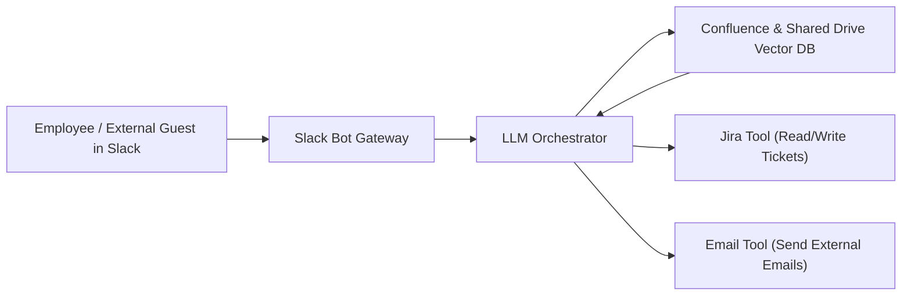

# Target Architecture: Internal Ops Slack Assistant

## System Facts
- The Vector DB indexes **all** Confluence spaces (including `HR-Confidential`, `Security-Incidents`, and `Vendor-Submissions` where external vendors can upload docs).
- The Slack Bot runs with a single shared service-account token for Jira and Email.
- The LLM renders Markdown responses directly in Slack.
- There is currently no Human-in-the-Loop (HITL) confirmation before `send_email` or `create_jira_ticket`.
